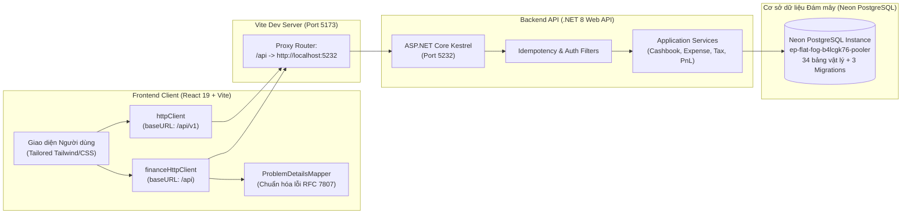

# BÁO CÁO 1: NHỮNG GÌ ĐÃ HOÀN THIỆN
## TIẾN TRÌNH KẾT NỐI BACKEND — FRONTEND (MT-GRMS)
**Hệ thống:** Quản trị Bán lẻ & Chuỗi Siêu thị Đa chi nhánh MT-GRMS  
**Cơ sở dữ liệu:** Neon PostgreSQL (Cloud Serverless)  
**Thời gian rà soát & kiểm toán:** 31/10/2026  
**Trạng thái chung:** **Đã hoàn thiện cốt lõi phân hệ Dòng tiền, Sổ quỹ, Thuế hộ kinh doanh & Nhà cung cấp.**

---

## I. TỔNG QUAN KIẾN TRÚC KẾT NỐI HẠ TẦNG

---

## II. CHI TIẾT CÁC PHÂN HỆ ĐÃ HOÀN THIỆN KẾT NỐI THẬT

### 1. Hạ tầng Cơ sở Dữ liệu & Kết nối Cloud Neon
- **Trạng thái:** **100% KẾT NỐI THẬT & HOẠT ĐỘNG THÔNG SUỐT**.
- **Cơ sở dữ liệu:** Neon PostgreSQL Serverless (`ep-flat-fog-b4lcgk76-pooler.c-6.us-east-2.aws.neon.tech:5432/neondb`).
- **Migrations:** Đã hoàn tất 3 bản migration vật lý vào Neon:
  1. `20261028093215_InitialPostgreSqlFull34Tables`: Tạo cấu trúc 34 bảng quan hệ toàn hệ thống.
  2. `20261028093300_AddSupplierBranchAssignmentsAndCutoff`: Bổ sung cấu trúc phân bổ nhà cung cấp chi nhánh.
  3. `20261029171902_AddTaxAndFinanceModules`: Bổ sung bảng Kê khai thuế hộ kinh doanh (`HouseholdTaxSnapshots`), Sổ quỹ (`CashBooks`, `BranchCashTills`), Phiếu chi (`ExpenseVouchers`), Sổ nợ (`CustomerDebtLedgers`), Khóa trùng lặp (`IdempotencyRecords`).
- **Seed Data tự động:** Cơ chế `DbInitializer.InitializeAsync` và `DatabaseSeeder.SeedAsync` tự động nạp dữ liệu mẫu chuỗi siêu thị MT-Mart (Chi nhánh Quận 1, Chi nhánh Cầu Giấy), Két tiền (Till 01, Till 02), Tài khoản quản trị và dữ liệu giao dịch mẫu.

---

### 2. Phân hệ Quản trị Sổ quỹ & Két tiền mặt (Cashbook & Branch Cash Till)
- **Tệp nguồn tích hợp:**
  + Frontend: [`cashbookService.ts`](file:///D:/Sourse_code_Do_An/MT_GRMS_FRONTEND/src/features/cashbook/services/cashbookService.ts)
  + Backend: [`CashbookController.cs`](file:///D:/Sourse_code_Do_An/MT_GRMS_BACKEND/src/MT_GRMS.Api/Controllers/CashbookController.cs)
- **Các API đã kết nối hoàn tất:**
  | Phương thức | Đường dẫn API | Chức năng nghiệp vụ | Đã kiểm thử |
  |---|---|---|:---:|
  | `POST` | `/api/cashbook/shifts/open` | Mở ca làm việc thu ngân, ghi nhận tiền đầu ca | Có |
  | `POST` | `/api/cashbook/shifts/close` | Đóng ca, xuất Báo cáo Z-Report, đối soát chênh lệch | Có |
  | `POST` | `/api/cashbook/cash-drops` | Rút tiền an toàn giữa ca nộp về quỹ chính (Cash Drop) | Có |
  | `POST` | `/api/cashbook/tills/transfer` | Điều chuyển tiền giữa các két / chi nhánh | Có |
  | `GET` | `/api/cashbook/entries` | Truy vấn nhật ký thu chi sổ quỹ có phân trang & lọc | Có |
  | `POST` | `/api/cashbook/entries/{id}/void` | Hủy / gạch bỏ bút toán sai sót có ghi nhận lý do | Có |
- **Điểm nổi bật:** Tự động sinh `X-Idempotency-Key` (UUIDv4) trên mọi request thay đổi dòng tiền để chống trừ tiền nhiều lần khi mạng chập chờn.

---

### 3. Phân hệ Quản trị Phiếu chi & Chi phí Vận hành (Service Expenses)
- **Tệp nguồn tích hợp:**
  + Frontend: [`expenseApi.ts`](file:///D:/Sourse_code_Do_An/MT_GRMS_FRONTEND/src/features/service-expenses/api/expenseApi.ts)
  + Backend: [`ExpensesController.cs`](file:///D:/Sourse_code_Do_An/MT_GRMS_BACKEND/src/MT_GRMS.Api/Controllers/ExpensesController.cs)
- **Các API đã kết nối hoàn tất:**
  | Phương thức | Đường dẫn API | Chức năng nghiệp vụ | Đã kiểm thử |
  |---|---|---|:---:|
  | `POST` | `/api/expenses` | Lập đề xuất phiếu chi (điện nước, mặt bằng, sửa chữa) | Có |
  | `POST` | `/api/expenses/{id}/approve` | Quản lý / Chủ cửa hàng phê duyệt phiếu chi | Có |
  | `POST` | `/api/expenses/{id}/disburse` | Thực chi tiền từ két tiền mặt hoặc tài khoản ngân hàng | Có |
  | `GET` | `/api/expenses/{id}` | Xem chi tiết phiếu chi và trạng thái chứng từ | Có |
- **Điểm nổi bật:** Tích hợp bộ chuyển đổi lỗi chuẩn [`problemDetailsMapper.ts`](file:///D:/Sourse_code_Do_An/MT_GRMS_FRONTEND/src/api/problemDetailsMapper.ts), biến các mã lỗi kỹ thuật ASP.NET thành thông điệp tiếng Việt thân thiện, rõ ràng.

---

### 4. Phân hệ Báo cáo Kết quả Kinh doanh Lãi - Lỗ (P&L Reports)
- **Tệp nguồn tích hợp:**
  + Frontend: [`reportsPnlService.ts`](file:///D:/Sourse_code_Do_An/MT_GRMS_FRONTEND/src/features/reports-pnl/services/reportsPnlService.ts)
  + Backend: [`PnLReportController.cs`](file:///D:/Sourse_code_Do_An/MT_GRMS_BACKEND/src/MT_GRMS.Api/Controllers/PnLReportController.cs)
- **Các API đã kết nối hoàn tất:**
  | Phương thức | Đường dẫn API | Chức năng nghiệp vụ | Đã kiểm thử |
  |---|---|---|:---:|
  | `GET` | `/api/finance/reports/pnl/summary` | Lấy chỉ số tổng hợp P&L: Doanh thu, COGS, Lợi nhuận gộp, Chi phí, EBIT, Lợi nhuận ròng | Có |
  | `GET` | `/api/finance/reports/pnl/drilldown` | Bóc tách chi tiết cơ cấu doanh thu theo ngành hàng và nhóm chi phí | Có |
- **Điểm nổi bật:** Backend gom truy vấn, loại trừ hoàn toàn nguy cơ N+1 Query khi tính toán báo cáo tài chính hợp nhất đa chi nhánh.

---

### 5. Phân hệ Kê khai Thuế Hộ Kinh Doanh & Chữ ký Niêm phong Toàn vẹn (Tax & HMAC Audit Seal)
- **Tệp nguồn tích hợp:**
  + Frontend: [`taxSnapshotApi.ts`](file:///D:/Sourse_code_Do_An/MT_GRMS_FRONTEND/src/features/tax-snapshot/api/taxSnapshotApi.ts)
  + Backend: [`HouseholdTaxController.cs`](file:///D:/Sourse_code_Do_An/MT_GRMS_BACKEND/src/MT_GRMS.Api/Controllers/HouseholdTaxController.cs)
- **Các API đã kết nối hoàn tất:**
  | Phương thức | Đường dẫn API | Chức năng nghiệp vụ | Đã kiểm thử |
  |---|---|---|:---:|
  | `GET` | `/api/tax/household/summary` | Ước tính nghĩa vụ thuế GTGT & TNCN theo NĐ 68/2026/NĐ-CP & NĐ 141 | Có |
  | `POST` | `/api/tax/household/snapshots` | Chốt kỳ tính thuế, sinh dấu niêm phong chống sửa đổi (HMAC-SHA256) | Có |
  | `GET` | `/api/tax/household/snapshots/{id}` | Tra cứu hồ sơ snapshot và xác minh tính toàn vẹn chữ ký | Có |
- **Điểm nổi bật:** Hỗ trợ cơ chế luân chuyển khóa chữ ký (HMAC Key Rotation) với `KeyId` định danh giúp bảo vệ tính pháp lý dữ liệu kế toán.

---

### 6. Phân hệ Quản trị Chi nhánh & Quản lý Nhà cung cấp
- **Tệp nguồn tích hợp:**
  + Chi nhánh: [`branchApi.ts`](file:///D:/Sourse_code_Do_An/MT_GRMS_FRONTEND/src/features/purchase-order/api/branchApi.ts) nối trực tiếp `GET /api/v1/branches`.
  + Nhà cung cấp: [`supplierApi.ts`](file:///D:/Sourse_code_Do_An/MT_GRMS_FRONTEND/src/features/supplier/api/supplierApi.ts) và [`supplierProductApi.ts`](file:///D:/Sourse_code_Do_An/MT_GRMS_FRONTEND/src/features/supplier/api/supplierProductApi.ts) nối trực tiếp `GET / POST / PUT /api/v1/suppliers`.
- **Điểm nổi bật:** Đồng bộ hai chiều giữa Enum dạng số của C# Backend (`Goods = 1, Service = 2, Both = 3`) và chuỗi TypeScript Frontend, đảm bảo dữ liệu hiển thị chính xác.

---

## III. TỔNG HỢP KẾT QUẢ KIỂM THỬ ĐÃ ĐẠT ĐƯỢC

1. **Backend (.NET 8):**
   - Đã vượt qua toàn bộ **169/169 Tests** (137 Unit Tests + 32 Integration Tests) không có bất kỳ test nào thất bại.
   - Biên dịch thành công 0 Warning nguy cấp, 0 Error.
2. **Frontend (React 19 + TypeScript):**
   - Đã vượt qua toàn bộ **87/87 Tests** trên 12 Test suites (Vitest).
   - Kiểm tra kiểu dữ liệu tĩnh (`tsc -b`) và đóng gói (`vite build`) thành công 100% trong 1.22 giây.
