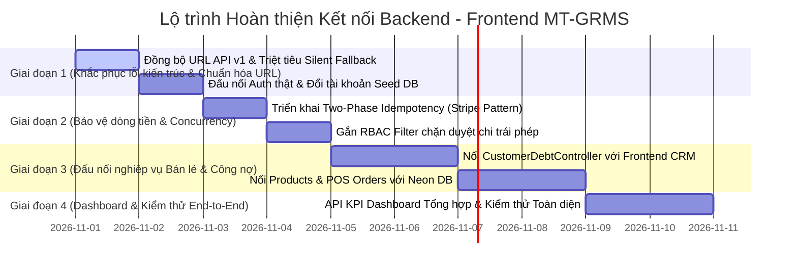

# BÁO CÁO 2: KẾ HOẠCH HOÀN THIỆN TIẾP THEO & CÁC ĐIỂM KHÚC MẮC CẦN QUYẾT ĐỊNH
## KIỂM TOÁN TẬN GỐC RỄ (ROOT OF SYSTEM) — ĐỒNG BỘ BACKEND & FRONTEND MT-GRMS
**Hệ thống:** Quản trị Bán lẻ & Chuỗi Siêu thị Đa chi nhánh MT-GRMS  
**Cơ sở dữ liệu:** Neon PostgreSQL Serverless  
**Mục đích:** Chỉ rõ điểm sai lệch kiến trúc, sai logic, nguy cơ tiềm ẩn cho hệ thống và trình bày các phương án để Bạn ra quyết định dứt điểm.

---

## I. PHÂN TÍCH BẢN CHẤT LỖI TẬN GỐC RỄ (ROOT CAUSE ANALYSIS)

### 1. Lỗi Lệch Tiền Tố URL (API Versioning Mismatch) & Bẫy "Silent Fallback"
- **Hiện tượng & Bản chất gốc rễ:**
  + Frontend có hai HTTP client:
    - `src/api/httpClient.ts`: Đặt `baseURL = '/api/v1'`.
    - `src/api/financeHttpClient.ts`: Đặt `baseURL = '/api'`.
  + Nhưng ở Backend (.NET 8):
    - `BranchesController`: `[Route("api/v1/branches")]` (Có `/v1`).
    - `SuppliersController`: `[Route("api/v1/suppliers")]` (Có `/v1`).
    - **NHƯNG** các controller trung tâm như `AuthController`, `OrdersController`, `ProductsController`, `CustomerDebtController` lại đặt `[Route("api/[controller]")]` (KHÔNG CÓ `/v1`).
  + **Hậu quả nghiêm trọng:** Khi Frontend gọi đăng nhập `POST /auth/login` bằng `httpClient`, request thực tế gửi đi là `/api/v1/auth/login`. Backend trả về **HTTP 404 Not Found**.
  + Khối `catch` trong [`authService.ts`](file:///D:/Sourse_code_Do_An/MT_GRMS_FRONTEND/src/features/auth/authService.ts) bắt được lỗi 404 này và **tự động fallback sang Mock User (`admin@mtgrms.vn / password123`)**.
  + **Đánh giá rủi ro:** ⛔ **CỰC KỲ NGUY HIỂM**. Đây là bẫy âm thầm ("Silent Fallback"): Lập trình viên tưởng rằng đăng nhập đã thành công từ backend thật, nhưng bản chất 100% người dùng vẫn đang thao tác trên bộ nhớ đệm giả lập của trình duyệt!

---

### 2. Lỗ Hổng Race Condition Trong Idempotency (Nguy Cơ Chi Tiền Hai Lần)
- **Cơ chế hiện tại trong [`IdempotencyFilter.cs`](file:///D:/Sourse_code_Do_An/MT_GRMS_BACKEND/src/MT_GRMS.Api/Filters/IdempotencyFilter.cs):**
  ```csharp
  // Bước 1: Kiểm tra bản ghi
  var existingRecord = await _context.IdempotencyRecords.FirstOrDefaultAsync(...);
  if (existingRecord != null) return ...;

  // Bước 2: Cho Controller chạy (tiền ĐÃ BỊ TRỪ trong két / tài khoản ngân hàng)
  var executedContext = await next();

  // Bước 3: Sau khi tiền đã trừ xong xuôi mới INSERT IdempotencyRecord
  _context.IdempotencyRecords.Add(record);
  await _context.SaveChangesAsync();
  ```
- **Hậu quả rủi ro dòng tiền:**
  + Khoảng thời gian từ Bước 1 đến Bước 3 kéo dài từ 300ms đến 2000ms.
  + Nếu mạng chậm, người dùng bấm đúp chuột (Double-Click) hoặc thiết bị di động tự động retry timeout: Cả Request 1 và Request 2 cùng vượt qua Bước 1. Cả 2 luồng đều gọi `next()` $\rightarrow$ **TIỀN BỊ TRỪ 2 LẦN TRONG KÉT HOẶC TÀI KHOẢN!**
  + Khi Request 2 chạy đến Bước 3 thì đụng Unique Constraint trong DB $\rightarrow$ Báo lỗi HTTP 500, nhưng **tiền đã mất từ Bước 2**.
- **Giải pháp triệt để:** Áp dụng **Two-Phase Idempotency (Stripe Pattern)**: INSERT bản ghi với trạng thái `Status = PENDING` ngay tại Bước 1 trước khi gọi `next()`. Request 2 đụng ngay `409 Conflict (IDEMPOTENCY_IN_PROGRESS)`, chặn đứng 100% việc trừ tiền kép.

---

### 3. Đứt Gãy Kết Nối: Backend Đã Sẵn Sàng Nhưng Frontend Vẫn Chạy Mock / LocalStorage
| Phân hệ | Tình trạng Backend (Đã code xong trên Neon DB) | Tình trạng Frontend hiện tại | Mức độ rủi ro & Tác động |
|---|---|---|---|
| **Bán hàng POS & Đơn hàng** | `OrdersController.cs` (Tạo đơn, lưu chi tiết giỏ hàng, trừ tồn kho) | `features/pos/mock/posMockData.ts` (100% Mock) | Thu tiền POS xong **không lưu vào cơ sở dữ liệu thật**, không nhảy số sổ quỹ két tiền. |
| **Hàng hóa & Danh mục** | `ProductsController.cs` (CRUD sản phẩm, đơn vị quy đổi, giá vốn) | `features/product/services/mockData.ts` (100% Mock) | Quản lý sản phẩm và tồn kho không ăn khớp với DB Neon. |
| **Công nợ Khách hàng** | `CustomerDebtController.cs` (Ghi nợ, Thu nợ, Cấn trừ hàng trả, Điều chỉnh) | `customerApi.ts` lưu vào `localStorage.getItem('MT_GRMS_CUSTOMERS_CACHE')` | Tắt trình duyệt hoặc đổi máy tính là mất sạch công nợ khách hàng; không đồng bộ với backend. |
| **Xác thực Đăng nhập (Auth)** | `AuthController.cs` cấp JWT token theo tài khoản DB (`admin / Admin@123`) | `authService.ts` trả token giả lập chuỗi timestamp | Bất kỳ ai cũng đăng nhập được mà không qua kiểm tra tài khoản bảo mật trong DB. |
| **Dashboard Tổng quan** | Chưa có Controller tổng hợp KPI | `features/finance/data/mockFinanceData.ts` | Số liệu doanh thu, chi phí, lợi nhuận trên trang chủ là số ảo. |

---

### 4. Lỗ Hổng Phân Quyền Vai Trò (RBAC Cash Flow Matrix)
- **Hiện trạng:**
  + Backend chưa gắn Authorize Policy chặn vai trò: Thu ngân (`CASHIER`) vẫn có thể gửi request gọi trực tiếp API `POST /api/expenses/{id}/approve` (Duyệt chi) hoặc `POST /api/cashbook/entries/{id}/void` (Gạch bỏ bút toán).
- **Nguy cơ gian lận nội bộ:** Thu ngân có thể tự lập phiếu chi, tự duyệt chi rồi rút tiền két bỏ túi, sau đó gạch bỏ bút toán mà không cần sự đồng ý của Chủ cửa hàng (`STORE_OWNER`) hay Quản lý (`BRANCH_MANAGER`).

---

### 5. Rủi Ro Tính Thuế Sai Lệch Do Giá Vốn (COGS Missing vs 0đ)
- **Hiện trạng:**
  + Khi một mặt hàng chưa kịp nhập giá vốn (trong DB `CostPrice == null`), hệ thống kế toán nếu tự động coi giá vốn là `0đ` sẽ làm:
    - Lợi nhuận gộp bị thổi phồng cực lớn.
    - Hộ kinh doanh lựa chọn nộp thuế theo phương pháp **15% Thu nhập thực tế** (NĐ 68/2026/NĐ-CP) sẽ bị truy thu thuế oan hàng chục đến hàng trăm triệu đồng do giá vốn bị tính bằng 0.
- **Giải pháp:** Bắt buộc phân định:
  + `CostPrice == null`: Thiếu giá vốn $\rightarrow$ Cảnh báo đỏ, chặn chốt sổ thuế kỳ đó cho đến khi cập nhật giá vốn.
  + `CostPrice == 0`: Hàng khuyến mại, quà tặng kèm hợp lệ.

---

## II. BẢNG CÁC ĐIỂM KHÚC MẮC CẦN BẠN QUYẾT ĐỊNH (DECISION MATRIX)

Dưới đây là 5 quyết định kiến trúc then chốt cần Bạn lựa chọn để định hình tiêu chuẩn phát triển cho toàn bộ dự án:

| # | Điểm khúc mắc cần quyết định | Phương án A (Khuyên Dùng) | Phương án B | Phân tích tác động |
|---|---|---|---|---|
| **D-01** | **Chuẩn hóa URL API Versioning** | **Toàn bộ Backend đổi thành `/api/v1/[controller]`** (Sửa route trong `AuthController`, `OrdersController`, `ProductsController`, `CustomerDebtController`, `CashbookController`, `ExpensesController`, `HouseholdTaxController`). | Bỏ `/v1` ở Frontend, toàn bộ hệ thống thống nhất dùng `/api/[controller]`. | **Phương án A chuẩn RESTful chuẩn quốc tế hơn**, giúp dễ nâng cấp API v2 sau này mà không làm vỡ app di động hoặc đối tác bên ngoài. |
| **D-02** | **Xử lý Mock Data ở Frontend** | **Chế độ "Hybrid / Dev-Safe":** Chỉ bật Mock khi chạy Unit Test (`MODE === 'test'`). Khi chạy Dev (`npm run dev`) phải gọi API thật, nếu Backend lỗi thì báo lỗi rõ ràng trên màn hình chứ không âm thầm fallback. | Bỏ hoàn toàn 100% Mock data khỏi Frontend ngay lập tức. | **Phương án A giữ an toàn cho Test suite hiện có**, đồng thời buộc giao diện phải phản ánh đúng lỗi kết nối của Backend, không bao giờ gây hiểu lầm cho người dùng. |
| **D-03** | **Cơ chế kiểm soát Tài khoản Đăng nhập** | **Đồng bộ hóa tài khoản Seed DB:** Thay thế toàn bộ Demo Account trên form login Frontend bằng tài khoản có sẵn trong Neon DB (`admin / Admin@123`, `manager01 / Manager@123`, `cashier01 / Cashier@123`). | Giữ nguyên danh sách demo Frontend và viết thêm migration bổ sung các tài khoản đó vào DB Neon. | **Phương án A tinh gọn nhất**, tận dụng ngay 3 tài khoản đã được phân quyền chặt chẽ trong `DbInitializer.cs`. |
| **D-04** | **Phân quyền duyệt chi & hủy sổ quỹ (RBAC)** | **Chặn cứng ở Backend:** Chỉ vai trò `STORE_OWNER`, `SUPER_ADMIN`, `BRANCH_MANAGER` mới có quyền duyệt chi (`ApproveExpense`) và gạch bỏ sổ quỹ (`VoidEntry`). Thu ngân chỉ được lập đề xuất chi (`CreateExpense`). | Phân quyền mềm ở giao diện Frontend (ẩn nút bấm, Backend không kiểm tra). | **Bắt buộc chọn Phương án A**. Phân quyền mềm ở Frontend vô tác dụng nếu người dùng có kiến thức kỹ thuật dùng Postman hoặc DevTools để gửi request. |
| **D-05** | **Chiến lược kết nối các phân hệ còn lại** | **Ưu tiên Dòng Tiền & Nghiệp Vụ Cốt Lõi:** Nối ngay Đăng nhập Auth thật $\rightarrow$ Khách hàng & Công nợ $\rightarrow$ Danh mục Sản phẩm & POS Bán hàng $\rightarrow$ Dashboard tổng quan. | Nối phân hệ Quản trị Admin và Gói phần mềm SaaS trước. | **Phương án A mang lại giá trị thực tế ngay lập tức**: Bạn có thể mở bán hàng thử, thu tiền vào két, xem doanh thu nhảy trực tiếp lên Neon DB. |

---

## III. KẾ HOẠCH HÀNH ĐỘNG CHI TIẾT (ACTIONABLE ROADMAP)



### Bước 1: Chuẩn hóa Route API & Nối Xác thực Đăng nhập Thật (Auth)
1. Thống nhất tiền tố `/api/v1` trên toàn bộ Backend Controllers hoặc Frontend `httpClient`.
2. Sửa `authService.ts`: Đăng nhập trực tiếp bằng endpoint `/api/v1/auth/login`, lưu `access_token` JWT thật vào `localStorage`.
3. Bổ sung các tài khoản mẫu khớp chính xác giữa DB Neon và Giao diện:
   - `admin` / `Admin@123` (Chủ hệ thống)
   - `manager01` / `Manager@123` (Quản lý chi nhánh)
   - `cashier01` / `Cashier@123` (Thu ngân quầy)

### Bước 2: Nâng cấp Two-Phase Idempotency & Bảo mật RBAC
1. Cập nhật `IdempotencyFilter.cs`: Thêm trạng thái `PENDING`, trả về `409 Conflict` nếu có request thứ 2 gửi đến đồng thời.
2. Thêm cột `UserId` vật lý vào bảng `IdempotencyRecords` và Unique Index `(TenantId, UserId, Endpoint, Key)`.
3. Bổ sung thuộc tính `[Authorize(Roles = "SUPER_ADMIN,STORE_OWNER,BRANCH_MANAGER")]` vào các endpoint nhạy cảm (`ApproveExpense`, `VoidEntry`).

### Bước 3: Đấu nối Sổ nợ Khách hàng (`CustomerDebt`) & Bán hàng POS (`Orders`)
1. Thay thế `localStorage` trong [`customerApi.ts`](file:///D:/Sourse_code_Do_An/MT_GRMS_FRONTEND/src/features/customer-crm/api/customerApi.ts) bằng các lệnh gọi trực tiếp đến `CustomerDebtController`.
2. Kết nối giao diện POS Bán hàng với `OrdersController`: Khi bấm "Thanh toán thành công" trên màn hình POS, hệ thống sẽ:
   - Tạo đơn hàng trong DB Neon.
   - Tự động trừ số lượng tồn kho theo sản phẩm.
   - Đổ số tiền mặt vào ca làm việc hiện tại của Két tiền (`BranchCashTill`).

### Bước 4: Xây dựng Endpoint KPI Dashboard & Kiểm toán Tự động
1. Tạo Controller `FinanceDashboardController` trả về các chỉ số realtime: Doanh thu ngày, Số dư các két tiền, Tiền mặt hiện có, Công nợ cần thu, Chi phí trong kỳ.
2. Nối trang Dashboard tài chính tổng quan để không còn dùng `mockFinanceData.ts`.
3. Chạy kiểm thử End-to-End kịch bản bán lẻ thực tế trên Neon PostgreSQL.
