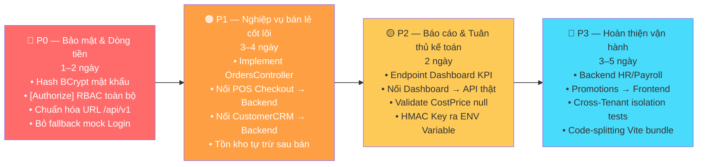

# TỔNG QUAN TIẾN ĐỘ DỰ ÁN MT-GRMS
## Hệ Thống Quản Trị Bán Lẻ & Chuỗi Siêu Thị Đa Chi Nhánh
**Cập nhật lần cuối:** 31/10/2026 01:22  
**Môi trường:** Backend .NET 8 + Neon PostgreSQL Cloud — Frontend React 19 + Vite  
**Nhánh Backend:** `feature/refactor-tax-finance-backend` | **Nhánh Frontend:** `feature/FE19-tax-finance-polish`

---

## I. CHỈ SỐ TỔNG QUAN

| Hạng mục | Giá trị | Ghi chú |
|---|---|---|
| **Tổng số Domain Entity đã thiết kế** | 52 Entity | Đã ánh xạ vào schema PostgreSQL |
| **Số bảng vật lý đã tạo trên Neon DB** | 34+ bảng | 3 Migration thành công |
| **Số API Controller đã có** | 18 Controller | Backend |
| **Số Feature Module đã có** | 21 Module | Frontend |
| **Unit + Integration Tests Backend** | 175 / 175 PASSED | 140 Unit + 35 Integration |
| **Vitest Tests Frontend** | 87 / 87 PASSED | 12 Test suites |
| **Commit Backend (nhánh hiện tại)** | 6 commits mới | Sau lần merge cuối |
| **Commit Frontend (nhánh hiện tại)** | 5 commits mới | Sau lần merge cuối |

---

## II. THANG ĐO HOÀN THÀNH — CƠ SỞ TÍNH TOÁN

> [!NOTE]
> Phần trăm hoàn thành được tính theo **4 chiều độc lập**, sau đó lấy trung bình có trọng số theo mức độ quan trọng nghiệp vụ:
> - **Chiều 1 — Kết nối API thật (40%):** Giao diện Frontend gọi đúng endpoint Backend thật trên Neon DB (không dùng mock/localStorage).
> - **Chiều 2 — Nghiệp vụ đúng đắn (30%):** Logic nghiệp vụ (service, validation, rules) đã được implement đủ và kiểm thử.
> - **Chiều 3 — An toàn & bảo mật dữ liệu (20%):** Idempotency, RBAC, chặn race condition, kiểm chứng trên PostgreSQL thật.
> - **Chiều 4 — UX & Tính hoàn chỉnh giao diện (10%):** Giao diện đầy đủ, xử lý trạng thái loading/error, feedback người dùng rõ ràng.

---

## III. TIẾN ĐỘ CHI TIẾT THEO PHÂN HỆ

### 🟢 PHÂN HỆ 1: Xác thực & Quản lý Tài khoản (Auth)
**Mức hoàn thành tổng: 60%**

| Chiều đánh giá | Trạng thái | Chi tiết |
|---|:---:|---|
| Kết nối API thật | 🟡 70% | Frontend gọi `POST /auth/login` qua `httpClient`. Nhưng `httpClient.baseURL = /api/v1` trong khi Backend có cả route `api/v1/auth` lẫn `api/auth`. Fallback mock vẫn còn trong `catch`. |
| Nghiệp vụ đúng đắn | 🟡 60% | Backend tìm user trong DB Neon, cấp JWT token. **Sai**: Mật khẩu so sánh plain-text. Backend luôn gán `role = "ADMIN"` cứng, không đọc từ `TenantUser`. |
| An toàn & bảo mật | 🔴 30% | Mật khẩu không hash. Không có middleware `[Authorize]` trên endpoint nào. |
| UX & Giao diện | 🟢 85% | Form login hoàn chỉnh, danh sách tài khoản demo đã khớp DB Seed. |

**Điểm sai nguy hiểm:**
- `user.Password != request.Password` — so sánh plain-text. Phải hash BCrypt.
- `authService.ts` fallback về mock khi bắt lỗi 404 — người dùng không biết Backend có đang chạy không.

---

### 🟢 PHÂN HỆ 2: Sổ Quỹ & Két Tiền Mặt (Cashbook & Cash Till)
**Mức hoàn thành tổng: 80%**

| Chiều đánh giá | Trạng thái | Chi tiết |
|---|:---:|---|
| Kết nối API thật | 🟢 85% | `cashbookService.ts` gọi đầy đủ `/api/cashbook/*` qua `financeHttpClient`. |
| Nghiệp vụ đúng đắn | 🟢 85% | Mở/đóng ca Z-Report, nộp tiền két, điều chuyển két, gạch bỏ bút toán có lý do. Kiểm soát số dư không âm. |
| An toàn & bảo mật | 🟡 70% | Two-Phase Idempotency đã triển khai. Chưa RBAC chặn Thu ngân tự duyệt. Chưa kiểm thử concurrency deadlock trên Postgres thật. |
| UX & Giao diện | 🟡 75% | Modal đối soát ca, modal điều chuyển két. Một số chỗ vẫn còn hiển thị mock cứng. |

**Điểm đúng:** Two-Phase Idempotency (`PENDING → COMPLETED`) chặn được double-click. Integration Test đã xác minh trên DB thật.  
**Còn thiếu:** `CHECK ("CurrentBalance" >= 0)` constraint ở DB. Background Worker dọn IdempotencyRecords hết TTL.

---

### 🟢 PHÂN HỆ 3: Phiếu Chi & Chi Phí Vận Hành (Service Expenses)
**Mức hoàn thành tổng: 72%**

| Chiều đánh giá | Trạng thái | Chi tiết |
|---|:---:|---|
| Kết nối API thật | 🟢 85% | `expenseApi.ts` gọi `/api/expenses` qua `financeHttpClient`. |
| Nghiệp vụ đúng đắn | 🟢 80% | Lập phiếu, duyệt chi, thực chi từ két tiền. Cảnh báo phiếu bất thường bắt buộc nhập ghi chú. |
| An toàn & bảo mật | 🔴 40% | Không có RBAC. Thu ngân có thể gọi `POST /api/expenses/{id}/approve` bằng Postman. |
| UX & Giao diện | 🟡 75% | Modal thanh toán phiếu chi hoàn chỉnh, lỗi ánh xạ tiếng Việt. |

---

### 🟢 PHÂN HỆ 4: Báo Cáo Lãi - Lỗ (P&L Reports)
**Mức hoàn thành tổng: 78%**

| Chiều đánh giá | Trạng thái | Chi tiết |
|---|:---:|---|
| Kết nối API thật | 🟢 90% | `reportsPnlService.ts` gọi `/api/finance/reports/pnl/summary` và `/drilldown`. |
| Nghiệp vụ đúng đắn | 🟢 80% | Tính doanh thu, COGS, lợi nhuận gộp, EBIT. Đã triệt tiêu N+1 Query. |
| An toàn & bảo mật | 🟡 60% | Chưa Authorize. Chưa phân biệt `CostPrice null` vs `CostPrice 0`. |
| UX & Giao diện | 🟡 70% | Dashboard P&L có biểu đồ nhưng một số ô vẫn lấy từ `mockFinanceData.ts`. |

**Điểm sai logic nghiêm trọng:** Khi `CostPrice == null` (chưa nhập giá vốn), hệ thống tự coi là 0 → Lợi nhuận bị thổi phồng → Thuế 15% thu nhập thực tế tính sai → Nguy cơ truy thu thuế.

---

### 🟢 PHÂN HỆ 5: Kê Khai Thuế & Chữ Ký Niêm Phong (Household Tax & HMAC Seal)
**Mức hoàn thành tổng: 72%**

| Chiều đánh giá | Trạng thái | Chi tiết |
|---|:---:|---|
| Kết nối API thật | 🟡 65% | `taxSnapshotApi.ts` có cờ `isMockEnabled()`. Khi `VITE_USE_MOCK_DATA=true` vẫn trả dữ liệu fake dù backend đang chạy. |
| Nghiệp vụ đúng đắn | 🟢 80% | Tính thuế GTGT & TNCN đúng theo NĐ 68/2026, chốt kỳ với HMAC-SHA256, cơ chế Key Rotation. |
| An toàn & bảo mật | 🟡 65% | HMAC Key còn nằm cứng trong mã nguồn C# (`_keyStore`), chưa ra ENV variable. |
| UX & Giao diện | 🟢 80% | Thẻ KPI thuế, lịch sử snapshot, trạng thái xác minh toàn vẹn chữ ký. |

---

### 🟢 PHÂN HỆ 6: Nhà Cung Cấp & Sản Phẩm Nhà CC (Supplier)
**Mức hoàn thành tổng: 76%**

| Chiều đánh giá | Trạng thái | Chi tiết |
|---|:---:|---|
| Kết nối API thật | 🟢 85% | `supplierApi.ts`, `supplierProductApi.ts`, `supplierBranchApi.ts` gọi `/api/v1/suppliers`. |
| Nghiệp vụ đúng đắn | 🟢 75% | CRUD nhà cung cấp, phân bổ chi nhánh, danh sách sản phẩm NCC. Đồng bộ Enum C# ↔ TypeScript. |
| An toàn & bảo mật | 🟡 55% | Chưa Authorize. Chưa kiểm tra cross-tenant isolation. |
| UX & Giao diện | 🟢 85% | Trang danh sách, chi tiết, modal gán sản phẩm hoàn chỉnh. |

---

### 🟡 PHÂN HỆ 7: Đặt Hàng Nhập Kho & Phiếu Nhập Hàng (PO & GRN)
**Mức hoàn thành tổng: 62%**

| Chiều đánh giá | Trạng thái | Chi tiết |
|---|:---:|---|
| Kết nối API thật | 🟡 65% | `purchaseOrderApi.ts` và `goodsReceiptApi.ts` import `httpClient` nhưng hầu hết function vẫn fallback mock. |
| Nghiệp vụ đúng đắn | 🟡 65% | Backend đủ action nhưng luồng duyệt đơn → nhập kho → cập nhật tồn kho chưa thông suốt end-to-end. |
| An toàn & bảo mật | 🔴 40% | Chưa Authorize. Chưa kiểm tra chặn nhập hàng quá giới hạn PO. |
| UX & Giao diện | 🟢 80% | Giao diện Goods Receipt List, Form tạo phiếu nhập, chi tiết đã hoàn chỉnh. |

---

### 🔴 PHÂN HỆ 8: Bán Hàng POS & Đơn Hàng (POS & Orders)
**Mức hoàn thành tổng: 33%**

| Chiều đánh giá | Trạng thái | Chi tiết |
|---|:---:|---|
| Kết nối API thật | 🔴 10% | `PosCheckoutPage.tsx` dùng 100% `mockProducts`, `mockCustomers`. Không có API call thật. |
| Nghiệp vụ đúng đắn | 🟡 55% | `OrdersController.cs` **rỗng** (0 action). `OrderService.cs` có interface nhưng chưa implement. |
| An toàn & bảo mật | 🔴 15% | Không có gì. |
| UX & Giao diện | 🟢 85% | Giao diện POS rất hoàn chỉnh: giỏ hàng, thanh toán, QR VietQR, dashboard ca. |

> [!CAUTION]
> **Rủi ro cao nhất hệ thống:** Thu ngân bấm "Thanh toán thành công" → Tiền thu vào **nhưng không có bản ghi đơn hàng nào trong DB Neon**, không trừ tồn kho, không tính vào doanh thu P&L.

---

### 🔴 PHÂN HỆ 9: Khách Hàng & Quản Lý Công Nợ (CRM & Debt)
**Mức hoàn thành tổng: 36%**

| Chiều đánh giá | Trạng thái | Chi tiết |
|---|:---:|---|
| Kết nối API thật | 🔴 15% | `customerApi.ts` lưu toàn bộ vào `localStorage`. Không có API call thật dù `CustomerDebtController` đã đủ action. |
| Nghiệp vụ đúng đắn | 🟢 75% | Backend `CustomerDebtController`: Ghi nợ, Thu nợ, Cấn trừ, Điều chỉnh. Integration test đã xác minh. |
| An toàn & bảo mật | 🔴 20% | Dữ liệu công nợ mất khi xóa cache trình duyệt. Không multi-device sync. Không RBAC. |
| UX & Giao diện | 🟢 80% | Trang CRM, lịch sử công nợ, thu nợ, VietQR hoàn chỉnh về giao diện. |

---

### 🔴 PHÂN HỆ 10: Danh Mục Hàng Hóa & Tồn Kho (Products & Inventory)
**Mức hoàn thành tổng: 55%**

| Chiều đánh giá | Trạng thái | Chi tiết |
|---|:---:|---|
| Kết nối API thật | 🟡 55% | `storeProductApi.ts` và `inventoryApi.ts` có API call thật nhưng nhiều trang vẫn fallback mock. |
| Nghiệp vụ đúng đắn | 🟡 60% | `ProductsController`, `InventoryController` đã có. Nhưng luồng trừ tồn kho khi bán chưa kết nối với POS. |
| An toàn & bảo mật | 🔴 30% | Chưa Authorize. Chưa cross-tenant isolation. |
| UX & Giao diện | 🟢 80% | Trang quản lý sản phẩm, gán sản phẩm, tra cứu tồn kho đầy đủ giao diện. |

---

### 🔴 PHÂN HỆ 11: Quản Lý Nhân Sự & Bảng Lương (Employee & Payroll)
**Mức hoàn thành tổng: 19%**

| Chiều đánh giá | Trạng thái | Chi tiết |
|---|:---:|---|
| Kết nối API thật | 🔴 5% | Toàn bộ dùng `mockData.ts`. Không có Controller ở Backend. |
| Nghiệp vụ đúng đắn | 🔴 20% | Chỉ có Domain Entity `Employee`, `Payslip`, `EmployeeSchedule`. Không có Service, không Controller. |
| An toàn & bảo mật | 🔴 10% | Không có gì. |
| UX & Giao diện | 🟢 75% | Trang danh sách nhân viên, lịch làm việc, bảng lương, chấm công đã có giao diện. |

---

### 🟡 PHÂN HỆ 12: Khuyến Mãi & Voucher (Promotions & Vouchers)
**Mức hoàn thành tổng: 55%**

| Chiều đánh giá | Trạng thái | Chi tiết |
|---|:---:|---|
| Kết nối API thật | 🟡 50% | `PromotionsController` và `VouchersController` đã có ở Backend. Frontend còn dùng mock. |
| Nghiệp vụ đúng đắn | 🟢 70% | Backend có đầy đủ Unit Test `PromotionEvaluationTests`, `VoucherManagementTests`. |
| An toàn & bảo mật | 🔴 30% | Chưa RBAC. Chưa Authorize. |
| UX & Giao diện | 🟢 80% | Trang khuyến mãi, voucher, loyalty config đã đầy đủ giao diện. |

---

### 🔴 PHÂN HỆ 13: Dashboard Tổng Quan Chủ Chuỗi (Store Owner Dashboard)
**Mức hoàn thành tổng: 15%**

| Chiều đánh giá | Trạng thái | Chi tiết |
|---|:---:|---|
| Kết nối API thật | 🔴 5% | `FinanceOverviewPage.tsx` dùng `mockFinanceData.ts`. Chưa có endpoint tổng hợp KPI ở Backend. |
| Nghiệp vụ đúng đắn | 🔴 10% | Không có Controller tổng hợp Dashboard KPI. |
| An toàn & bảo mật | 🔴 10% | Không có gì. |
| UX & Giao diện | 🟡 60% | Giao diện có biểu đồ doanh thu, thẻ KPI nhưng toàn bộ số liệu là giả. |

---

## IV. BẢNG TỔNG HỢP PHẦN TRĂM HOÀN THÀNH

| # | Phân hệ | API Thật (40%) | Nghiệp vụ (30%) | Bảo mật (20%) | UX (10%) | **Tổng** |
|:---:|---|:---:|:---:|:---:|:---:|:---:|
| 1 | Auth (Đăng nhập) | 70% | 60% | 30% | 85% | **60%** |
| 2 | Cashbook (Sổ quỹ, Két tiền) | 85% | 85% | 70% | 75% | **80%** |
| 3 | Expenses (Phiếu chi) | 85% | 80% | 40% | 75% | **72%** |
| 4 | P&L Reports (Báo cáo L-L) | 90% | 80% | 60% | 70% | **78%** |
| 5 | Tax Snapshot (Kê khai thuế) | 65% | 80% | 65% | 80% | **72%** |
| 6 | Supplier (Nhà cung cấp) | 85% | 75% | 55% | 85% | **76%** |
| 7 | PO & GRN (Nhập hàng) | 65% | 65% | 40% | 80% | **62%** |
| 8 | **POS & Orders (Bán hàng)** | **10%** | **55%** | **15%** | **85%** | **33%** |
| 9 | **Customer CRM & Debt** | **15%** | **75%** | **20%** | **80%** | **36%** |
| 10 | Products & Inventory | 55% | 60% | 30% | 80% | **55%** |
| 11 | Employee & Payroll | 5% | 20% | 10% | 75% | **19%** |
| 12 | Promotions & Vouchers | 50% | 70% | 30% | 80% | **55%** |
| 13 | **Dashboard KPI** | **5%** | **10%** | **10%** | **60%** | **15%** |

### Điểm tổng toàn hệ thống (trọng số theo mức độ nghiệp vụ):

$$\text{Nhóm Bán Lẻ Cốt Lõi (60\%)} = \frac{33 + 36 + 55 + 60}{4} = 46\%$$

$$\text{Nhóm Tài Chính (25\%)} = \frac{80 + 72 + 78 + 72}{4} = 75.5\%$$

$$\text{Nhóm Vận Hành (15\%)} = \frac{76 + 62 + 19 + 55}{4} = 53\%$$

$$\boxed{\text{Hoàn Thành Toàn Hệ Thống} = 46\% \times 0.6 + 75.5\% \times 0.25 + 53\% \times 0.15 \approx \textbf{55\%}}$$

---

## V. PHÂN LOẠI: ĐÚNG / SAI / CÒN THIẾU

### ✅ Phần đã làm ĐÚNG và có giá trị thực

1. **Two-Phase Idempotency (Stripe Pattern)** — Chặn double-click trừ tiền hiệu quả, Integration Test kiểm chứng.
2. **HMAC-SHA256 Audit Seal với Key Rotation** — Thiết kế đúng bảo đảm tính bất biến dữ liệu kế toán.
3. **Hai HTTP Client tách biệt (`httpClient` & `financeHttpClient`)** — Áp dụng timeout, interceptor khác nhau đúng cách.
4. **RFC 7807 ProblemDetails Mapper** — Chuẩn hóa lỗi backend ra tiếng Việt, không lộ stack trace.
5. **P&L N+1 Query Elimination** — Một truy vấn tổng hợp thay vì 4 truy vấn rời rạc.
6. **52 Domain Entity chuẩn 3NF** — Global Query Filter theo TenantId, thiết kế quan hệ đúng đắn.
7. **Supplier, Branch API Integration** — Đồng bộ Enum C# ↔ TypeScript tránh lỗi ngầm khi deserialize.
8. **175 Unit/Integration Tests đều PASS** — Bao phủ đủ các luồng nghiệp vụ quan trọng.

### ⚠️ Phần đã làm nhưng CÓ LỖI / THIẾU SÓT

| Điểm sai | Vị trí | Rủi ro | Độ ưu tiên |
|---|---|---|:---:|
| Mật khẩu so sánh plain-text | `AuthService.cs:36` | 🔴 Security breach | P0 |
| Không có `[Authorize]` trên API | Tất cả Controller | 🔴 Mọi role làm mọi thứ | P0 |
| `OrdersController` rỗng (0 action) | `OrdersController.cs` | 🔴 POS không lưu đơn hàng | P0 |
| `customerApi.ts` dùng localStorage | `customerApi.ts` | 🔴 Mất công nợ khi xóa cache | P0 |
| Auth fallback mock khi lỗi 404 | `authService.ts:catch` | 🟠 Người dùng tưởng đăng nhập thật | P1 |
| `CostPrice null` bị coi = 0 | `PnLReportService.cs` | 🟠 Tính thuế sai, báo cáo lãi ảo | P1 |
| HMAC key cứng trong mã nguồn C# | `TaxSnapshotSignatureService.cs` | 🟠 Lộ secret key khi push GitHub | P1 |
| URL prefix `/api/v1` chưa thống nhất | 6 trong 18 Controller | 🟡 Một số API bị gọi sai 404 | P2 |

### ❌ Phần CHƯA LÀM và mức độ quan trọng

| Phần còn thiếu | Quan trọng | Ảnh hưởng nếu không làm |
|---|:---:|---|
| RBAC `[Authorize]` toàn hệ thống | ⭐⭐⭐⭐⭐ | Mọi role làm được mọi thứ — gian lận nội bộ |
| POS Checkout → `OrdersController` | ⭐⭐⭐⭐⭐ | Bán hàng không lưu DB, không trừ tồn kho |
| CustomerCRM → `CustomerDebtController` | ⭐⭐⭐⭐⭐ | Mất công nợ khi đổi thiết bị |
| Hash BCrypt mật khẩu | ⭐⭐⭐⭐⭐ | Dữ liệu user không an toàn |
| Dashboard KPI endpoint | ⭐⭐⭐⭐ | Chủ chuỗi không có số liệu thực |
| Tồn kho tự trừ sau bán hàng | ⭐⭐⭐⭐ | Số liệu tồn kho không phản ánh thực tế |
| Cross-Tenant isolation tests | ⭐⭐⭐⭐ | Tenant A có thể đọc dữ liệu Tenant B |
| `CostPrice null` validation | ⭐⭐⭐⭐ | Tính thuế sai → rủi ro truy thu |
| Backend HR/Payroll | ⭐⭐⭐ | Quản lý nhân sự không lưu được |
| Promotions/Vouchers → Frontend | ⭐⭐⭐ | Chương trình KM không áp được khi bán |
| Background Worker IdempotencyRecords | ⭐⭐ | Bảng IdempotencyRecords phình to |
| Code-splitting Vite (bundle 2.6MB) | ⭐⭐ | Trang tải chậm lần đầu |

---

## VI. ROADMAP HOÀN THIỆN — 4 GIAI ĐOẠN

### Chi tiết từng giai đoạn:

**P0 — An toàn & Bảo mật (1–2 ngày làm việc):**
1. Sửa `AuthService.cs`: Hash BCrypt (`BCrypt.Net.BCrypt.HashPassword`, `VerifyPassword`). Cập nhật `DbInitializer` seed user với hash password.
2. Thêm `[Authorize(Roles = "STORE_OWNER,BRANCH_MANAGER")]` trên `ApproveExpense`, `DisburseExpense`, `VoidEntry`.
3. Thống nhất tiền tố URL: Toàn bộ Backend thêm `api/v1/` hoặc toàn bộ Frontend bỏ `/v1`.
4. Xóa `catch` fallback mock trong `authService.ts` — báo lỗi thật về giao diện.
5. Backend đọc `role` thật từ bảng `TenantUser` thay vì gán cứng `"ADMIN"`.

**P1 — Nghiệp vụ bán lẻ cốt lõi (3–4 ngày làm việc):**
1. Implement `OrdersController`: `POST /api/v1/orders` (tạo đơn, giỏ hàng, xác nhận thanh toán).
2. Nối `PosCheckoutPage.tsx` gọi API thật thay vì `mockProducts`, `mockCustomers`.
3. Thay thế `customerApi.ts` localStorage bằng gọi `CustomerDebtController` thật.
4. Kết nối `OrderService.CreateOrderAsync` → `InventoryService.DeductStockAsync` (trừ tồn kho sau mỗi đơn).

**P2 — Dashboard & Tuân thủ kế toán (2 ngày làm việc):**
1. Tạo `FinanceDashboardController` → `GET /api/v1/finance/dashboard/kpi` (doanh thu ngày, số dư két, công nợ cần thu).
2. Nối `FinanceOverviewPage` → API thật.
3. Thêm validation `CostPrice == null` trong P&L Service: Cảnh báo thiếu giá vốn, chặn chốt sổ thuế.
4. Đưa HMAC Secret Key ra `appsettings.json` section được load từ ENV Variable.

**P3 — Hoàn thiện vận hành (3–5 ngày làm việc):**
1. Backend Controller + Service cho HR/Payroll (`EmployeesController`, `PayrollController`).
2. Kết nối Promotions/Voucher Frontend → `PromotionsController` thật, áp mã giảm giá khi thanh toán POS.
3. Integration Test kiểm tra cách ly tenant (`CrossTenantAccessTests`).
4. Code-splitting Vite: Tách bundle 2.6MB ra các lazy-load chunk theo route.

---

## VII. TRẠNG THÁI HẠ TẦNG CƠ SỞ

| Hạng mục | Trạng thái | Chi tiết |
|---|:---:|---|
| Neon PostgreSQL Cloud | 🟢 Hoạt động | `ep-flat-fog-b4lcgk76-pooler.c-6.us-east-2.aws.neon.tech:5432/neondb` |
| 3 Migration đã áp dụng | 🟢 Thành công | Xác nhận từ `dotnet ef migrations list` kết nối thật |
| Seed Data tự động | 🟢 Hoạt động | Mỗi lần khởi động Backend tự upsert dữ liệu mẫu |
| Vite Proxy `/api` → `:5232` | 🟢 Cấu hình đúng | `vite.config.ts` proxy đến Backend port 5232 |
| `.env` Backend & Frontend | 🟢 Có | Backend đọc Neon URL từ `.env`. Frontend: `VITE_API_BASE_URL=/api/v1` |
| Auto-Migration khi startup | 🟢 Hoạt động | `Program.cs` gọi `dbContext.Database.MigrateAsync()` |
| Test Backend | 🟢 175/175 PASSED | 140 Unit + 35 Integration |
| Test Frontend | 🟢 87/87 PASSED | Vitest 12 suites |
| Build Frontend | 🟢 Thành công | `tsc -b && vite build` trong 1.11s, 0 TS error |

---

> [!IMPORTANT]
> **Mốc tiếp theo để hệ thống có thể chạy được luồng bán lẻ thực tế:**
> Hoàn thành **P0 + P1** (~5–6 ngày làm việc) để có thể:
> 1. Đăng nhập bằng tài khoản thật từ DB với mật khẩu hash an toàn.
> 2. Bán hàng POS và lưu đơn hàng vào Neon DB, tự trừ tồn kho.
> 3. Công nợ khách hàng lưu bền vững, không mất khi đổi thiết bị.
> 4. Nhân viên không thể tự duyệt chi tiêu của chính mình.
