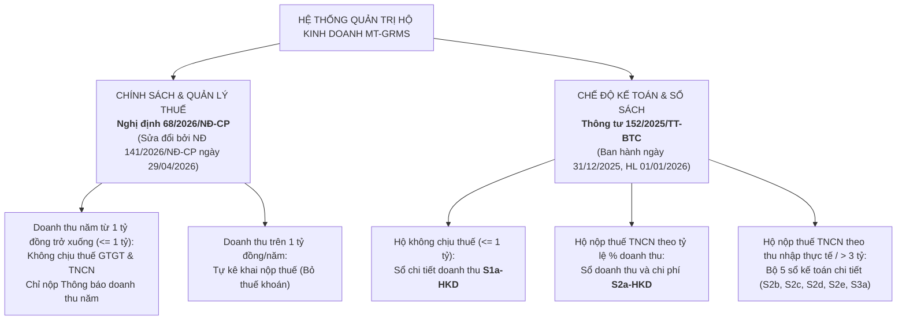

# BÁO CÁO KIỂM TOÁN NỘI BỘ & CHECKLIST NGHIỆM THU KỸ THUẬT (PHIÊN BẢN CHUẨN HÓA TOÀN DIỆN)
## HỆ THỐNG QUẢN TRỊ BÁN LẺ ĐA TIỆM & ĐA CHI NHÁNH (MT-GRMS)
**Thời gian rà soát:** 30/10/2026  
**Tính chất tài liệu:** Báo cáo tự kiểm toán kỹ thuật nội bộ (Internal Engineering Audit). Toàn bộ kết quả kiểm thử hiện tại chạy trên môi trường giả lập bộ nhớ (**Store: `Microsoft.EntityFrameworkCore.InMemory`**), chưa chạy trên engine PostgreSQL thật.

---

### 1. PHÂN TÍCH BẤT CẬP KIẾN TRÚC & HẠ TẦNG

#### 1.1. Lỗ Hổng Race Condition Trong Idempotency (Nguy Cơ Chi Tiền Hai Lần)
- **Cơ chế hiện tại trong [`IdempotencyFilter.cs`](file:///d:/Sourse_code_Do_An/MT_GRMS_BACKEND/src/MT_GRMS.Api/Filters/IdempotencyFilter.cs):**
  1. Đọc kiểm tra `existingRecord` từ bảng `IdempotencyRecords`.
  2. Nếu chưa có, thực thi controller: `var executedContext = await next();` (nghiệp vụ chi tiền / trừ két ĐÃ HOÀN TẤT trong cơ sở dữ liệu).
  3. Sau khi controller chạy xong, filter mới thực hiện: `_context.IdempotencyRecords.Add(record); await _context.SaveChangesAsync();`.
- **Rủi ro thực tế:**
  + Cửa sổ race condition kéo dài **toàn bộ thời gian xử lý của request đầu** (300ms - 2000ms tùy mạng và DB).
  + Khi người dùng bấm đúp hoặc mobile retry do timeout: Cả Request 1 và Request 2 cùng vượt qua bước 1 vì bản ghi chưa tồn tại. Cả hai request đều gọi `next()` $\rightarrow$ **TIỀN BỊ TRỪ / CHI HAI LẦN TRONG KÉT**.
  + Sau đó, Request 1 INSERT bản ghi thành công (HTTP 200). Request 2 INSERT sau đụng Unique Index $\rightarrow$ ném `DbUpdateException` $\rightarrow$ trả về HTTP 500.
  + **Hậu quả:** Tiền đã bị thất thoát hai lần trước khi lỗi 500 xuất hiện!
- **Giải pháp bắt buộc (Ưu tiên 1):**
  + Chuyển sang mô hình **Two-Phase Idempotency (Stripe Pattern)**: INSERT bản ghi với trạng thái `Status = PENDING` **TRƯỚC KHI** gọi `next()`.
  + Nếu request thứ 2 đến trong lúc request 1 đang chạy $\rightarrow$ Đụng Unique Index ngay tại bước đầu $\rightarrow$ Trả về ngay HTTP `409 Conflict (IDEMPOTENCY_IN_PROGRESS)`, bảo vệ an toàn dòng tiền tuyệt đối.
  + Thêm cột `UserId` vật lý vào bảng `IdempotencyRecords` và tạo chỉ mục Unique trên `(TenantId, UserId, Endpoint, Key)` thay vì ghép chuỗi thủ công vào cột `Key`.

#### 1.2. Môi Trường Kiểm Thử Hiện Tại Chưa Kiểm Chứng Được Concurrency & Deadlock
- **Thực trạng kiểm thử:** Toàn bộ 32 test thuộc dự án `MT_GRMS.IntegrationTests` và 137 unit tests đang chạy trên store **`Microsoft.EntityFrameworkCore.InMemory`** (hoàn tất trong 2.1 giây).
- **Hạn chế của InMemory Store:**
  + Không kiểm tra ràng buộc khóa duy nhất (Unique Index).
  + Không hỗ trợ câu lệnh khóa dòng PostgreSQL `SELECT ... FOR UPDATE` (lệnh này bị EF Core InMemory bỏ qua hoàn toàn).
  + Không có cơ chế Transaction Isolation (Read Committed / Serializable).
  + Không thể mô phỏng hay phát hiện Deadlock giữa các luồng đồng thời.
- **Biện pháp khắc phục:** Cần thiết lập test suite chạy trên PostgreSQL thật (sử dụng Docker Testcontainers hoặc Neon Temporary Branch) để kiểm chứng cơ chế khóa dòng và deadlock.

#### 1.3. Cấu Hình Tự Động Retry Cho Npgsql Trong EF Core
- **Giải pháp thực hành an toàn:** Không cần viết `CustomNpgsqlExecutionStrategy` phức tạp. EF Core cung cấp sẵn tham số `errorCodesToAdd` trong overload của `EnableRetryOnFailure`:
  ```csharp
  options.UseNpgsql(connectionString, b =>
  {
      b.EnableRetryOnFailure(
          maxRetryCount: 5,
          maxRetryDelay: TimeSpan.FromSeconds(30),
          errorCodesToAdd: new[] { "40P01" }); // Bổ sung DeadlockDetected (40P01) vào danh sách transient retry
  });
  ```
  Cách cấu hình này an toàn tuyệt đối trong mọi phiên bản Npgsql (kể cả khi `40P01` đã là transient hay chưa).
- **Ràng buộc khi có Transaction:** Khi sử dụng execution strategy, mọi khối giao dịch có `BeginTransactionAsync` bắt buộc phải được bọc bên trong `strategy.ExecuteAsync(async () => { using var tx = ... })` để tránh lỗi `InvalidOperationException`.

---

### 2. PHÂN ĐỊNH PHÁP LÝ & CƠ CHẾ SỔ SÁCH - THUẾ CHUẨN XÁC



#### 2.1. Căn Cứ Pháp Lý & Danh Mục Thuế Suất Theo Ngành Nghề:
1. **Nghị định 68/2026/NĐ-CP (sửa đổi bởi Nghị định 141/2026/NĐ-CP ngày 29/04/2026):**
   - Hộ kinh doanh có doanh thu trong năm dương lịch **từ 01 tỷ đồng trở xuống** (`Revenue <= 1_000_000_000`) không phải nộp thuế GTGT và thuế TNCN. Hộ chỉ nộp Thông báo doanh thu, không phải kê khai nộp thuế theo kỳ.
   - **Xóa bỏ cơ chế thuế khoán:** Toàn bộ hộ kinh doanh chuyển sang cơ chế tự khai, tự nộp.
2. **Thuế suất đầy đủ theo danh mục ngành nghề (Thông tư 40/2021/TT-BTC & NĐ 68/141):**
   - Thuế suất không được gán cứng mà phải truy xuất theo ngành nghề kinh doanh đăng ký:
     + **Phân phối, cung cấp hàng hóa (bán lẻ):** GTGT 1.0%, TNCN 0.5% (tính trên phần doanh thu lũy kế vượt 1 tỷ).
     + **Dịch vụ, xây dựng không bao thầu NVL:** GTGT 5.0%, TNCN 2.0% (tính trên phần doanh thu lũy kế vượt 1 tỷ).
     + **Sản xuất, vận tải, dịch vụ có gắn với hàng hóa:** GTGT 3.0%, TNCN 1.5% (tính trên phần doanh thu lũy kế vượt 1 tỷ).
     + **Cho thuê tài sản, cho thuê bất động sản:** GTGT 5.0%, TNCN 5.0% (tính trên phần doanh thu lũy kế vượt 1 tỷ).
     + **Hoạt động kinh doanh khác:** GTGT 2.0%, TNCN 1.0% (tính trên phần doanh thu lũy kế vượt 1 tỷ).
   - **Cảnh báo vượt ngưỡng giữa năm (lời văn trung tính theo ngành):**
     > *"Doanh thu lũy kế năm đã vượt ngưỡng 1 tỷ VNĐ trong kỳ này. Hệ thống bắt đầu tính nghĩa vụ thuế GTGT và TNCN theo thuế suất ngành nghề đăng ký trên phần doanh thu vượt ngưỡng. Khuyến nghị chủ hộ tham vấn cơ quan thuế địa bàn về quy định kê khai và chính sách áp dụng cho trường hợp vượt ngưỡng giữa năm."*
3. **Quy Tắc Áp Dụng Phương Án Kê Khai Thu Nhập Thực Tế (`PROFIT_15`):**
   - Theo Điều 4 Nghị định 68/2026/NĐ-CP: Hộ kinh doanh lựa chọn phương pháp tính thuế theo thu nhập thực tế (doanh thu trừ chi phí) phải **áp dụng ổn định trong thời gian tối thiểu 02 năm liên tục**.
   - **Quy tắc chuyển đổi phương pháp khi vượt ngưỡng 3 tỷ:** Hộ kinh doanh đang áp dụng phương pháp tỷ lệ % trên doanh thu mà trong năm có tổng doanh thu thực tế vượt quá 3 tỷ đồng thì từ năm tính thuế tiếp theo bắt buộc phải chuyển sang phương pháp tính thuế theo thu nhập thực tế.
   - Các mức thuế suất theo thu nhập chịu thuế:
     + *Trên 1 tỷ đến 3 tỷ (Nhóm 2):* Được chọn giữa Tỷ lệ % doanh thu hoặc 15% trên thu nhập chịu thuế.
     + *Trên 3 tỷ đến 50 tỷ (Nhóm 3):* Bắt buộc phương pháp thu nhập thực tế, thuế suất 17%.
     + *Trên 50 tỷ (Nhóm 4):* Thuế suất 20% trên thu nhập chịu thuế.
   - Bắt buộc phân loại chi phí hợp lý được trừ (có hóa đơn, chứng từ hợp pháp) và chi phí không được trừ.
4. **Quy Tắc Phân Nhóm Sổ Kế Toán Theo Thông Tư 152/2025/TT-BTC:**
   - **Khóa phân nhóm sổ kế toán chính là Phương Pháp Tính Thuế TNCN Đã Chọn:**
     + *Hộ từ 1 tỷ trở xuống (không chịu thuế):* Sử dụng sổ chi tiết doanh thu **S1a-HKD** để làm căn cứ nộp Thông báo doanh thu năm.
     + *Hộ nộp thuế TNCN theo phương pháp Tỷ lệ % doanh thu (dưới 3 tỷ):* Sử dụng sổ doanh thu và chi phí **S2a-HKD**.
     + *Hộ nộp thuế TNCN theo phương pháp Thu nhập thực tế (`PROFIT_15` hoặc trên 3 tỷ):* Bắt buộc sử dụng bộ sổ kế toán chi tiết:
       - **S2b-HKD:** Sổ chi tiết chi phí sản xuất, kinh doanh.
       - **S2c-HKD:** Sổ chi tiết vật liệu, dụng cụ, sản phẩm, hàng hóa.
       - **S2d-HKD:** Sổ theo dõi tình hình thực hiện nghĩa vụ thuế với NSNN.
       - **S2e-HKD:** Sổ theo dõi tiền lương và các khoản nộp theo lương.
       - **S3a-HKD:** Sổ quỹ tiền mặt, tiền gửi ngân hàng.

---

### 3. CHECKLIST NGHIỆM THU KỸ THUẬT (CHUẨN HÓA 3 TRẠNG THÁI)

**Quy ước 3 trạng thái chuẩn:**
1. **`[XONG & CÓ TEST]`**: Đã cài đặt hoàn chỉnh + Đã có test kiểm chứng chạy đạt kết quả PASS (ghi rõ tên hàm test và file test).
2. **`[ĐÃ CODE, CHƯA ĐỦ ĐIỀU KIỆN]`**: Đã viết mã nguồn logic nhưng chưa chạy trên PostgreSQL thật, hoặc tham số còn là const, hoặc mới chặn tầng C# chưa có DB constraint/trigger, hoặc test mới ở mức mock in-memory.
3. **`[CHƯA LÀM]`**: Hạng mục đã ghi nhận trong yêu cầu nhưng chưa triển khai mã nguồn.

| STT | Hạng Mục Nghiệp Vụ / Kỹ Thuật | Trạng Thái | Bằng Chứng / Tên Test & Mã Nguồn | Loại Khoảng Trống Kỹ Thuật |
|:---:|:---|:---:|:---|:---|
| **1** | Công thức thuế NĐ 68/141 (Từ 1 tỷ trở xuống miễn thuế, YTD Excess) | **[ĐÃ CODE, CHƯA ĐỦ ĐIỀU KIỆN]** | `RevenuePercentageTaxStrategyTests.Calculate_WhenRevenueOverThreshold_ShouldCalculateTaxesCorrectly` | Ngưỡng 1 tỷ và thuế suất đang là `const` trong C#, **chưa động hóa bảng DB có `ValidFrom`**. |
| **2** | Cảnh báo vượt ngưỡng giữa năm (lời văn trung tính theo ngành) | **[XONG & CÓ TEST]** | - BE: `HouseholdTaxServiceTests.GetTaxSummary_WhenThresholdCrossedMidYear_ShouldSetFlagAndNeutralNote`<br/>- FE: `taxSnapshotBPrime.test.ts` (assert neutral note) | Đã chuẩn hóa lời văn theo ngành nghề trung tính, có test ở cả 2 đầu. |
| **3** | Tùy chọn thuế TNCN 15% lợi nhuận (`PROFIT_15`) | **[ĐÃ CODE, CHƯA ĐỦ ĐIỀU KIỆN]** | `HouseholdTaxServiceTests.GetTaxSummary_Group2_WhenTier2MethodIsProfit15_ShouldUseDeclarationStrategyWith15PercentPit` | Chưa lưu cấu hình phương pháp vào DB; **Chưa có ràng buộc khóa tối thiểu 2 năm liên tiếp** (Điều 4 NĐ 68). |
| **4** | Sổ cái bất biến (Compensating Ledger) | **[ĐÃ CODE, CHƯA ĐỦ ĐIỀU KIỆN]** | `CashbookServiceTests.VoidTransactionAsync_ShouldCreateCompensatingEntries` | Gạch bỏ tạo phiếu bù trừ `COMPENSATING`; **Chưa có PostgreSQL Trigger và chưa thu hồi quyền UPDATE/DELETE của DB role**. |
| **5** | Poka-yoke chống âm két tiền mặt (GBR-CSH-03) | **[ĐÃ CODE, CHƯA ĐỦ ĐIỀU KIỆN]** | `CashbookServiceTests.CreatePaymentAsync_WhenInsufficientFunds_ShouldThrowException` | Mới chặn ở tầng C#; **Chưa có ràng buộc DB `CHECK (CurrentBalance >= 0)` và chưa test `SELECT FOR UPDATE` trên Postgres thật**. |
| **6** | Bắt buộc giải trình kiểm kê chênh lệch (GBR-CSH-04) | **[XONG & CÓ TEST]** | `CashbookServiceTests.ReconcileCashAccountAsync_WhenDiscrepancyWithoutReason_ShouldThrowException` | Chặn lỗi `REASON_REQUIRED` khi chênh lệch != 0. |
| **7** | Chống Deadlock khi chuyển tiền nội bộ | **[ĐÃ CODE, CHƯA ĐỦ ĐIỀU KIỆN]** | `CashbookService.TransferFundsAsync`<br/>`CashbookServiceTests.TransferFundsAsync_StandardTransfer_ShouldTransferBalancesCorrectly`<br/>`CashbookServiceTests.TransferFundsAsync_WhenFromAndToAccountsAreSame_ShouldThrowBusinessException`<br/>`CashbookServiceTests.TransferFundsAsync_WhenAmountIsZeroOrNegative_ShouldThrowBusinessException` | Đã code khóa `firstId` và `secondId` theo thứ tự ID + Transaction + Chặn From = To và Số tiền <= 0; **Nhưng mới test in-memory, chưa test concurrency đa luồng trên Postgres thật**. |
| **8** | Idempotency Scope (Tenant + User + Endpoint + Key) | **[XONG & CÓ TEST]** | `IdempotencyFilterTests.OnActionExecutionAsync_ScopeIncludesUserId_DifferentUsersCanUseSameKey` | User khác nhau gửi cùng key không bị nhận nhầm cache (Scope ghép chuỗi `{UserId}:{Key}`). |
| **9** | Idempotency Tamper Detection (409 Conflict) | **[XONG & CÓ TEST]** | `IdempotencyFilterTests.OnActionExecutionAsync_WhenSameKeyDifferentPayload_ShouldReturn409Conflict` | Bắt lỗi `IDEMPOTENCY_PAYLOAD_MISMATCH` khi cùng key nhưng payload bị sửa. |
| **10**| Idempotency Không Cache Lỗi 4xx (Cho phép Retry) | **[XONG & CÓ TEST]** | `IdempotencyFilterTests.OnActionExecutionAsync_When4xxStateErrorOccurs_ShouldNotCacheAndAllowRetry` | Gặp lỗi trạng thái (`INSUFFICIENT_FUNDS`), client nạp tiền và retry cùng key thành công 200. |
| **11**| Idempotency Không Cache Lỗi 5xx (Server Recovery) | **[XONG & CÓ TEST]** | `IdempotencyFilterTests.OnActionExecutionAsync_When5xxServerErrorOccurs_ShouldNotCacheAndAllowRetry` | Server lỗi 500 không bị cache, khi server phục hồi retry cùng key trả về 200. |
| **12**| Idempotency Two-Phase Xử lý Race Condition (Trạng thái PENDING) | **[XONG & CÓ TEST]** | `IdempotencyFilterTests.OnActionExecutionAsync_WhenConcurrentRequestWhilePending_ShouldReturn409ConflictInProgress`<br/>`IdempotencyFilterTests.OnActionExecutionAsync_WhenPendingRecordExpiredDueToCrash_ShouldReclaimLockAndSucceed`<br/>`IdempotencyFilterTests.OnActionExecutionAsync_WhenUnhandledExceptionOccurs_ShouldRemovePendingRecordAndAllowRetry` | **Đã triển khai Two-Phase Idempotency (Stripe Pattern)**: Ghi bản ghi `Status = PENDING` và `UserId` TRƯỚC KHI gọi `next()`. Request song song bị chặn đứng với 409 `IDEMPOTENCY_IN_PROGRESS`. Tự động xóa PENDING khi lỗi/exception để client retry; Thành công 2xx chuyển `COMPLETED`. Tự dọn dẹp lock treo quá hạn. |
| **13**| Anti-Splitting Hạn Mức T1 & Tần Suất 60 phút | **[ĐÃ CODE, CHƯA ĐỦ ĐIỀU KIỆN]** | `ExpenseServiceTests.CreateExpenseAsync_WhenThresholdExceeded_ShouldRequireApproval`<br/>`ExpenseServiceTests.CreateExpenseAsync_WhenFrequencyPatternDetected_ShouldFlagSuspiciousSplit` | Đã quét theo thời gian và vendor trong ngày; **Chưa quét đa chiều theo Người thụ hưởng (Beneficiary) và Chi nhánh (Branch)**. |
| **14**| Quy tắc duyệt chi tiệm 1 chủ solo có cảnh báo | **[ĐÃ CODE, CHƯA ĐỦ ĐIỀU KIỆN]** | `ExpenseServiceTests.ApproveExpenseAsync_WhenFlaggedAsSuspiciousAndNoteIsEmpty_ShouldThrowBusinessException` | Mới bắt buộc nhập Note; **Chưa có bảng Audit Log chuyên biệt lưu vết kiểm toán hệ thống**. |
| **15**| Dấu toàn vẹn HMAC Snapshot có Key Rotation | **[ĐÃ CODE, CHƯA ĐỦ ĐIỀU KIỆN]** | `TaxSnapshotSignatureTests.VerifySignature_WithKeyRotation_ShouldVerifyHistoricSnapshotsCorrectly` | Đã code KeyId rotation; **Secret key còn nằm trong mã nguồn C# (`_keyStore`), chưa đưa ra biến môi trường / Key Vault**. |
| **16**| Triệt tiêu N+1 Query trong Báo cáo P&L | **[ĐÃ CODE, CHƯA ĐỦ ĐIỀU KIỆN]** | `PnLReportServiceTests.GetPnLSummaryAsync_StandardCase_ShouldCalculateCorrectMetrics` | Đã gom 4 hàm repo; **Test hiện tại chỉ mock repo và tính margin%, chưa có test assert đếm số lượng câu lệnh SQL thực tế trên DB**. |
| **17**| Chế độ sổ sách theo Phương pháp TNCN (TT 152) | **[CHƯA LÀM]** | Mới có DTO phân loại trong `HouseholdTaxDtos.cs` | Chưa có giao diện UI xem/kết xuất sổ S1a, S2a, và bộ sổ chi tiết (S2b-S2e, S3a). Cần cấu hình động theo Phương pháp tính thuế TNCN. |
| **18**| Phân biệt Giá vốn COGS thiếu vs COGS 0đ | **[CHƯA LÀM]** | Đã có metadata `cogsSource` | **Chưa phân biệt trường hợp thiếu giá vốn (`CostPrice == null`) với hàng tặng kèm (`CostPrice == 0`)**, gây rủi ro thổi phồng lợi nhuận và thuế 15%. |
| **19**| Phân quyền theo vai trò (RBAC Matrix Dòng Tiền) | **[CHƯA LÀM]** | - | **Chưa triển khai** chặn vai trò Thu ngân/Nhân viên duyệt chi hoặc gạch bỏ bút toán sổ cái. |
| **20**| Cách ly Tenant (Chặn truy cập chéo) | **[CHƯA LÀM]** | - | **Chưa có Integration Test** kiểm chứng chặn truy cập chéo giữa các tenant. |
| **21**| Quản lý Công nợ khách hàng / NCC theo FIFO | **[CHƯA LÀM]** | - | Chưa triển khai cơ chế phân bổ thanh toán công nợ theo nguyên tắc First-In-First-Out. |
| **22**| Dashboard Tài chính kết nối API thật | **[CHƯA LÀM]** | Màn hình P&L và Tax đã nối API; Dashboard tổng quan còn dùng `mockFinanceData.ts` | Cần nối endpoint tổng hợp `/api/finance/dashboard/kpi`. |
| **23**| Contract Test / OpenAPI & Enum Dạng Chuỗi | **[CHƯA LÀM]** | - | Cần chuẩn hóa `JsonStringEnumConverter` trên toàn bộ DTO API để tránh lệch contract giữa C# và TypeScript. |
| **24**| Guard an toàn cho script smoke test Live DB | **[ĐÃ CODE, CHƯA ĐỦ ĐIỀU KIỆN]** | `smoke_test_stage3.py` (`check_safety_guards`) | Đã viết logic từ chối chạy nếu URL là production hoặc tenant không thuộc tiền tố test; Chưa có test script tự động. |

---

### 4. TỔNG HỢP KIỂM THỬ THỰC TẾ TRÊN MÁY DEV

```bash
# Backend (.NET 8) - Store: Microsoft.EntityFrameworkCore.InMemory
dotnet test MT_GRMS_BACKEND.sln
# Passed! - Failed: 0, Passed: 169, Skipped: 0, Total: 169 (Duration: 2.1s)
# Phân rã:
# - MT_GRMS.UnitTests: 137 passed (đã có test chặn From == To và Amount <= 0 trong TransferFunds)
# - MT_GRMS.IntegrationTests: 32 passed (chạy trên InMemory)

# Frontend (Vite / React 19)
npm test -- --run
# Test Files: 12 passed (12), Tests: 87 passed (87) (Duration: 4.16s)
# Build check: tsc -b && vite build hoàn tất trong 1.22s (0 lỗi TypeScript compile)
```

---

### 5. TÁI CẤU TRÚC LỘ TRÌNH KỸ THUẬT (THEO NGUYÊN TẮC AN TOÀN DÒNG TIỀN)

Thứ tự ưu tiên được sắp xếp lại dựa trên mức độ rủi ro thất thoát tiền tệ và toàn vẹn dữ liệu:

1. **Ưu tiên 1 (Khắc phục lỗ hổng chi tiền 2 lần do Race Condition Idempotency):**
   - Triển khai mô hình **Two-Phase Idempotency (Stripe Pattern)**: INSERT bản ghi với trạng thái `Status = PENDING` vào DB *TRƯỚC KHI* thực thi nghiệp vụ chi tiền / trừ két.
   - Nếu request thứ 2 gửi đến trong cửa sổ xử lý (bấm đúp, timeout retry) $\rightarrow$ Trả về ngay `409 Conflict (IDEMPOTENCY_IN_PROGRESS)`, chặn đứng 100% rủi ro chi tiền hai lần.
   - Thêm cột `UserId` vật lý vào bảng `IdempotencyRecords` và Index `(TenantId, UserId, Endpoint, Key)`.
   - Thêm Background Worker tự động dọn dẹp bản ghi hết hạn TTL 24h.
2. **Ưu tiên 2 (Kiểm soát gian lận dòng tiền & Bảo mật rò rỉ dữ liệu đa Tenant):**
   - Triển khai phân quyền RBAC: Chặn cứng vai trò Thu ngân / Nhân viên không được duyệt chi (`ApproveExpense`) và không được gạch bỏ bút toán sổ cái (`VoidTransaction`).
   - Viết Integration Test kiểm tra chặn truy cập chéo tenant (`CrossTenantAccessTests`).
   - Bảo mật chữ ký HMAC: Đưa Secret Key ra khỏi mã nguồn C#, nạp qua biến môi trường (`ENV_HMAC_SECRET`) hoặc Key Vault.
3. **Ưu tiên 3 (Kiểm chứng Concurrency & Deadlock trên PostgreSQL Engine thật):**
   - Xây dựng bộ test Concurrency đa luồng trên PostgreSQL thật (sử dụng Docker Testcontainers hoặc Neon DB Branching tạm thời).
   - Cấu hình `EnableRetryOnFailure(errorCodesToAdd: new[] { "40P01" })` cho Npgsql và bọc giao dịch qua `executionStrategy.ExecuteAsync()` để tự động retry khi gặp mã lỗi PostgreSQL `40P01` (deadlock_detected) và `40001` (serialization_failure).
   - Bổ sung ràng buộc `CHECK ("CurrentBalance" >= 0)` hoặc lệnh `UPDATE ... WHERE "CurrentBalance" >= @Amount` ở DB để chặn âm két ở tầng database engine.
   - Áp dụng triệt để quy tắc sắp thứ tự khóa tài nguyên (Deterministic Resource Ordering) cho mọi luồng liên quan nhiều tài khoản (chi tiền, rút két, trả nợ, nộp ngân hàng).
4. **Ưu tiên 4 (Động hóa bảng tham số thuế, Đầy đủ các nhóm ngành & Ràng buộc PROFIT_15):**
   - Tạo Entity `TaxPolicyParameter` trong DB có các cột `ParameterKey`, `ParameterValue`, `ValidFrom`, `ValidTo` thay vì `const` cứng trong C#.
   - Bổ sung bảng thuế suất theo danh mục các nhóm ngành nghề: Bán lẻ (1%/0.5%), Dịch vụ (5%/2%), Sản xuất/vận tải (3%/1.5%), Cho thuê tài sản (5%/5%), Khác (2%/1%).
   - Thêm ràng buộc cho phương án `PROFIT_15`: Khóa áp dụng tối thiểu 2 năm liên tiếp theo Điều 4 NĐ 68; quy tắc chuyển đổi bắt buộc sang phương pháp thu nhập nếu doanh thu cuối năm vượt 3 tỷ; kiểm tra phân loại chi phí hợp lệ / không hợp lệ.
   - Phân biệt rõ trường hợp thiếu giá vốn (`CostPrice == null`) vs hàng khuyến mại tặng kèm (`CostPrice == 0`) để tránh thổi phồng lợi nhuận và thuế 15%.
   - Thiết kế phân nhóm sổ sách kế toán theo Phương pháp tính thuế TNCN (hộ từ 1 tỷ trở xuống không chịu thuế dùng S1a, hộ nộp theo % doanh thu dùng S2a, hộ nộp theo thu nhập thực tế dùng bộ sổ chi tiết S2b-S2e, S3a).
   - Chuẩn hóa OpenAPI contract test & Enum dạng chuỗi (`JsonStringEnumConverter`).
5. **Ưu tiên 5 (Nghiệp vụ Mở Rộng: Quản lý Công nợ FIFO, Sổ sách TT 152 & Dashboard):**
   - Triển khai phân bổ thanh toán công nợ khách hàng và nhà cung cấp theo nguyên tắc First-In-First-Out.
   - Xây dựng giao diện xem và kết xuất các nhóm biểu mẫu sổ sách theo TT 152 và tờ khai thuế theo TT 18/TT 50.
   - Đấu nối Dashboard tài chính với API thật.

