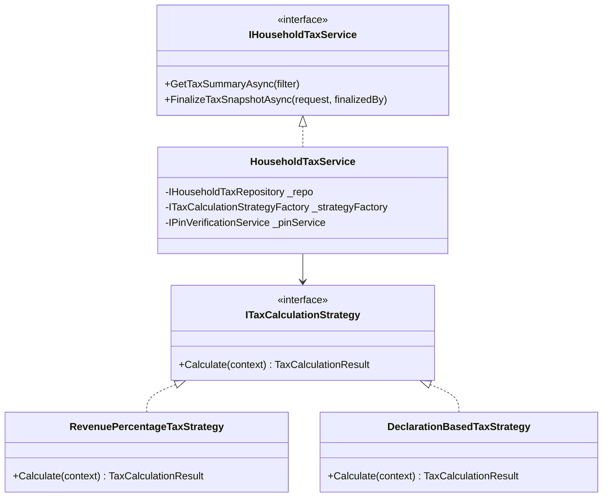

# BÁO CÁO ĐÁNH GIÁ KIẾN TRÚC & QUY CHUẨN BACKEND PHÂN HỆ TÀI CHÍNH - THUẾ (MT-GRMS)

> **Mục đích tài liệu:** Cung cấp đầy đủ bối cảnh hệ thống, kiến trúc, quy chuẩn thiết kế SOLID, đánh giá mã nguồn hiện tại và hướng dẫn refactor chi tiết để bất kỳ AI hoặc Lập trình viên mới (chưa có ngữ cảnh từ trước) có thể tiếp nhận, phân tích và triển khai ngay lập tức.
>
> **Phiên bản:** 1.0 - Ngày kiểm toán: 28/10/2026  
> **Dự án:** MT-GRMS (Phần mềm Quản lý Tiệm Tạp Hóa Bán Lẻ Đa Chi Nhánh)  
> **Ngôn ngữ & Nền tảng Backend:** .NET 8 WebAPI, C# 12, Entity Framework Core, PostgreSQL  

---

## MỤC LỤC
1. [Bối cảnh nghiệp vụ & Mô hình dữ liệu chuẩn (Domain Context)](#1-bối-cảnh-nghiệp-vụ--mô-hình-dữ-liệu-chuẩn)
2. [Hiện trạng cấu trúc mã nguồn Backend phân hệ Tài chính](#2-hiện-trạng-cấu-trúc-mã-nguồn-backend-phân-hệ-tài-chính)
3. [Đánh giá quy chuẩn SOLID & Dependency Injection (DI)](#3-đánh-giá-quy-chuẩn-solid--dependency-injection-di)
4. [Đánh giá tính đúng đắn về Logic Tài chính & Thuế](#4-đánh-giá-tính-đúng-đắn-về-logic-tài-chính--thuế)
5. [Đánh giá Bảo mật, Mã PIN chốt kỳ & Tính bất biến (Immutability)](#5-đánh-giá-bảo-mật-mã-pin-chốt-kỳ--tính-bất-biến-immutability)
6. [Đánh giá Hệ thống 5 Sổ kế toán HKD](#6-đánh-giá-hệ-thống-5-sổ-kế-toán-hkd)
7. [Bảng đối soát sai lệch & Rủi ro kỹ thuật](#7-bảng-đối-soát-sai-lệch--rủi-ro-kỹ-thuật)
8. [Kế hoạch Refactor & Mã nguồn C# chuẩn mẫu](#8-kế-hoạch-refactor--mã-nguồn-c-chuẩn-mẫu)

---

## 1. BỐI CẢNH NGHIỆP VỤ & MÔ HÌNH DỮ LIỆU CHUẨN

### 1.1. Bối cảnh Hộ kinh doanh cá thể (HKD)
- **Cửa hàng mẫu:** Tiệm Tạp Hóa Cô Ba (Bán lẻ bánh kẹo, đồ uống, nhu yếu phẩm tiêu dùng nhanh FMCG).
- **Quy định phân nhóm hộ kinh doanh:**
  - **Nhóm 1 (Doanh thu năm $\le$ 1 tỷ đồng):** Miễn thuế GTGT và TNCN. Sử dụng Sổ S1a-HKD.
  - **Nhóm 2 (Doanh thu năm 1 – 3 tỷ đồng):** Chịu thuế GTGT (1% trên toàn bộ doanh thu phát sinh trong kỳ vượt ngưỡng); chịu thuế TNCN (0.5% tính trên phần doanh thu lũy kế vượt ngưỡng 1 tỷ). Áp dụng Sổ S2a-HKD (hoặc bộ 4 sổ S2b..S2e nếu kê khai).
  - **Nhóm 3 (Doanh thu năm 3 – 50 tỷ đồng) & Nhóm 4 (> 50 tỷ đồng):** Bắt buộc chuyển sang phương pháp Kê khai (Doanh thu – Chi phí hợp lý) hoặc chế độ kế toán doanh nghiệp siêu nhỏ.

### 1.2. Bộ số đối soát chuẩn năm 2026 (Benchmark Figures)
| Kỳ tính thuế | Doanh thu phát sinh kỳ | Doanh thu lũy kế YTD | Trạng thái ngưỡng | Thuế GTGT (1%) | Thuế TNCN (0.5%) | Tổng thuế phải nộp |
| :--- | :---: | :---: | :---: | :---: | :---: | :---: |
| **Quý 1/2026** | 470.000.000đ | 470.000.000đ | Chưa vượt 1 tỷ | 0đ | 0đ | **0đ** (Đã chốt) |
| **Quý 2/2026** | 480.000.000đ | 950.000.000đ | Chưa vượt 1 tỷ | 0đ | 0đ | **0đ** (Đã chốt) |
| **Quý 3/2026** *(Kỳ khảo sát)* | **467.500.000đ** | **1.417.500.000đ** | **VƯỢT TRẦN 417.5tr** | **4.675.000đ** | **2.087.500đ** | **6.762.500đ** |

*Công thức tính Quý 3/2026 chuẩn:*
- **GTGT Quý 3:** $467.500.000 \times 1\% = 4.675.000đ$ *(nếu áp dụng giảm 20% theo NQ 204 thì là 0.8% = 3.740.000đ)*.
- **TNCN Quý 3:** $(1.417.500.000 - 1.000.000.000) \times 0.5\% - 0đ = 417.500.000 \times 0.5\% = 2.087.500đ$.
- **Tổng thuế Quý 3:** $4.675.000 + 2.087.500 = \mathbf{6.762.500đ}$.
- **Hạn nộp:** 31/10/2026 rơi vào Thứ Bảy $\rightarrow$ Tự động dời sang ngày làm việc tiếp theo: **Thứ Hai, 02/11/2026**.

---

## 2. HIỆN TRẠNG CẤU TRÚC MÃ NGUỒN BACKEND PHÂN HỆ TÀI CHÍNH

Hệ thống Backend được tổ chức theo mô hình Layered / Onion Architecture:
```
D:\Sourse_code_Do_An\MT_GRMS_BACKEND\
├── src/
│   ├── MT_GRMS.Api/                         # Lớp Presentation (REST Controllers)
│   │   └── Controllers/
│   │       ├── HouseholdTaxController.cs   # API Tờ khai thuế, 5 sổ HKD, Snapshot
│   │       ├── CashbookController.cs       # API Sổ quỹ tiền mặt & ngân hàng
│   │       └── PnLReportController.cs      # API Báo cáo kết quả kinh doanh P&L
│   ├── MT_GRMS.Application/                 # Lớp Nghiệp vụ (Use Cases, DTOs, Interfaces)
│   │   ├── Tax/
│   │   │   ├── IHouseholdTaxService.cs     # Interface dịch vụ thuế
│   │   │   ├── HouseholdTaxService.cs      # Triển khai tính thuế, chốt kỳ
│   │   │   ├── IHouseholdTaxRepository.cs  # Interface truy vấn thuế
│   │   │   └── Dtos/HouseholdTaxDtos.cs    # DTOs tờ khai & snapshot
│   │   ├── Cashbook/                       # Service & DTOs sổ quỹ
│   │   └── Reports/                        # Service & DTOs P&L
│   ├── MT_GRMS.Domain/                      # Lớp Thực thể cốt lõi (Entities & Enums)
│   │   ├── Entities/Finance/
│   │   │   ├── HouseholdTaxSnapshot.cs     # Thực thể Snapshot chốt kỳ
│   │   │   ├── CashbookEntry.cs            # Thực thể bút toán sổ quỹ
│   │   │   └── CashbookTransaction.cs      # Giao dịch thu/chi
│   │   └── Enums/TaxEnums.cs               # Enums nhóm thuế, phương pháp
│   └── MT_GRMS.Infrastructure/              # Lớp Hạ tầng (EF Core & Repositories)
│       ├── Persistence/AppDbContext.cs     # DbContext kết nối PostgreSQL
│       └── Repositories/
│           ├── HouseholdTaxRepository.cs   # Query Orders, ExpenseVouchers, Snapshots
│           ├── CashbookRepository.cs       # Query Cashbook transactions
│           └── PnLReportRepository.cs      # Query Revenue & COGS
```

---

## 3. ĐÁNH GIÁ QUY CHUẨN SOLID & DEPENDENCY INJECTION (DI)

### 3.1. Dependency Inversion Principle (D trong SOLID) & Liên kết lỏng (Loose Coupling)
- **Đánh giá: ĐẠT (9/10).**
- **Điểm tích cực:**
  - Controller **HOÀN TOÀN KHÔNG** inject trực tiếp `AppDbContext` hay concrete class. `HouseholdTaxController` chỉ giao tiếp qua `IHouseholdTaxService`.
  - Service `HouseholdTaxService` **HOÀN TOÀN KHÔNG** phụ thuộc vào EF Core hay DbContext; nó chỉ giao tiếp qua abstraction `IHouseholdTaxRepository`.
  - Cả `IHouseholdTaxService` và `IHouseholdTaxRepository` đều được đăng ký vòng đời Scoped đúng chuẩn trong `Application/DependencyInjection.cs` và `Infrastructure/DependencyInjection.cs`:
    ```csharp
    services.AddScoped<IHouseholdTaxService, HouseholdTaxService>();
    services.AddScoped<IHouseholdTaxRepository, HouseholdTaxRepository>();
    ```
  - Thiết kế này cho phép viết Unit Tests cô lập hoàn toàn (`HouseholdTaxServiceTests.cs` đạt 8/8 tests passed khi mock Repository mà không cần database).

### 3.2. Single Responsibility Principle (S trong SOLID)
- **Đánh giá: CẦN CẢI THIỆN (6/10).**
- **Vấn đề tồn tại:**
  - `HouseholdTaxService` đang gánh vác quá nhiều trách nhiệm (God Service):
    1. Xác định kỳ và khoảng ngày UTC (`GetDateRangesForPeriod`).
    2. Xác định nhóm hộ kinh doanh theo ngưỡng doanh thu (`DetermineHouseholdGroup`).
    3. Tính toán thuế theo tỷ lệ % (GTGT + TNCN lũy kế YTD).
    4. Tính toán thuế theo phương pháp Kê khai (Doanh thu - Chi phí).
    5. Kiểm tra tuần tự kỳ thuế để chốt kỳ.
    6. Serialize dữ liệu chứng từ sổ sách thành JSON để lưu snapshot.
- **Giải pháp:** Tách logic tính thuế thành một Domain Service / Strategy chuyên biệt (`ITaxCalculationStrategy`), giải phóng Service chỉ còn làm nhiệm vụ Orchestration (Điều phối quy trình).

### 3.3. Open/Closed Principle (O trong SOLID)
- **Đánh giá: CHƯA ĐẠT (5/10).**
- **Vấn đề tồn tại:**
  - Phương pháp tính thuế (`RevenuePercentage` vs `DeclarationBased`) đang được rẽ nhánh bằng khối lệnh `if (isDeclaration) { ... } else { ... }` dài hơn 80 dòng trong `HouseholdTaxService.cs`.
  - Khi Nhà nước ban hành chính sách mới (ví dụ: phương pháp Thuế khoán cố định, hoặc phương pháp kết hợp), bắt buộc phải mở file `HouseholdTaxService.cs` ra sửa đổi trực tiếp, vi phạm nguyên lý Open for extension, Closed for modification.
- **Giải pháp:** Áp dụng **Strategy Pattern**:
  - `ITaxCalculationStrategy` có 2 class triển khai:
    - `RevenuePercentageStrategy` (Theo tỷ lệ % doanh thu).
    - `DeclarationBasedStrategy` (Theo doanh thu - chi phí thực tế).

### 3.4. Interface Segregation Principle (I trong SOLID)
- **Đánh giá: KHÁ (7/10).**
- `IHouseholdTaxRepository` hiện đang tích hợp cả việc truy vấn doanh thu (`GetPeriodRevenueAsync`), truy vấn chi phí (`GetPeriodDeductibleExpensesAsync`), truy vấn sổ sách (`GetBookEntriesAsync`), và thao tác Snapshot (`AddSnapshotAsync`, `GetSnapshotAsync`).
- Khuyến nghị: Trong tương lai khi hệ thống mở rộng, nên tách thành `ITaxQueryRepository` (đọc dữ liệu bán hàng & chi phí) và `ITaxSnapshotRepository` (quản lý snapshot chốt kỳ).

---

## 4. ĐÁNH GIÁ TÍNH ĐÚNG ĐẮN VỀ LOGIC TÀI CHÍNH & THUẾ

### 4.1. LỖI NGHIÊM TRỌNG: Thiếu Giá Vốn Hàng Bán (COGS) trong Phương pháp Kê khai
- **Hiện trạng mã nguồn tại [HouseholdTaxRepository.cs](file:///D:/Sourse_code_Do_An/MT_GRMS_BACKEND/src/MT_GRMS.Infrastructure/Repositories/HouseholdTaxRepository.cs#L85-L105):**
  ```csharp
  public async Task<decimal> GetPeriodDeductibleExpensesAsync(...)
  {
      var voucherQuery = _context.ExpenseVouchers.AsQueryable();
      // ... lọc theo ExpenseDate và Status ...
      var vouchers = await voucherQuery.ToListAsync(cancellationToken);
      // Loại trừ vốn chủ sở hữu
      var validVouchers = vouchers.Where(v => ...);
      return validVouchers.Sum(v => v.Amount); // CHỈ TỔNG HỢP PHIẾU CHI DỊCH VỤ!
  }
  ```
- **Hậu quả nghiệp vụ:**
  - Đối với cửa hàng tạp hóa, tiền mua hàng đầu vào từ Nhà cung cấp (Giá vốn hàng bán - COGS) chiếm tới **65% - 75%** doanh thu. Chi phí dịch vụ (`ExpenseVouchers`: điện, nước, internet, bao bì...) chỉ chiếm khoảng **3% - 5%** doanh thu.
  - Khi Backend tính: $\text{Thu nhập chịu thuế} = \text{Doanh thu} - \text{Chi phí hợp lý}$, do bỏ quên COGS, Backend tính ra chi phí chỉ có ~20 triệu $\rightarrow$ Lợi nhuận chịu thuế bị đội lên **447.5 triệu** (thay vì thực tế chỉ khoảng **120 triệu**).
  - Thuế TNCN phương pháp Kê khai bị nhân lên gấp **gần 4 lần** một cách phi lý!
  - Trong khi đó, tại [PnLReportRepository.cs](file:///D:/Sourse_code_Do_An/MT_GRMS_BACKEND/src/MT_GRMS.Infrastructure/Repositories/PnLReportRepository.cs#L45-L60), hệ thống đã có sẵn logic tính COGS:
    ```csharp
    decimal totalCogs = orders.Sum(o => o.Items.Any()
        ? o.Items.Sum(i => i.Quantity * i.UnitPrice * 0.70m)
        : o.SubTotal * 0.70m);
    ```
- **Giải pháp bắt buộc:** Cập nhật `GetPeriodDeductibleExpensesAsync` để tính:
  $$\text{DeductibleExpenses} = \text{COGS (Từ hóa đơn nhập hàng / GRN)} + \text{OPEX (Từ ExpenseVouchers)}$$

### 4.2. Logic lũy kế năm (YTD) và Khấu trừ ngưỡng 1 tỷ
- **Đánh giá: ĐẠT CHUẨN.**
- Backend tính đúng: Thuế GTGT tính trên toàn bộ 467.5tr của Quý 3 (vì Quý 3 là kỳ phát sinh doanh thu vượt ngưỡng).
- Thuế TNCN được khấu trừ phần 1 tỷ: Chỉ tính trên phần vượt $1.417.500.000đ - 1.000.000.000đ = 417.500.000đ$.
- Đã có cơ chế trừ đi số thuế TNCN đã kê khai ở các kỳ trước (`PriorDeclaredPitTax`).

---

## 5. ĐÁNH GIÁ BẢO MẬT, MÃ PIN CHỐT KỲ & TÍNH BẤT BIẾN (IMMUTABILITY)

### 5.1. Lỗ hổng: Bỏ qua kiểm tra mã PIN tại Server
- **Hiện trạng:**
  - Client gửi lên `CreateTaxSnapshotRequest` có trường `SecurityPin`.
  - Tại [HouseholdTaxService.FinalizeTaxSnapshotAsync](file:///D:/Sourse_code_Do_An/MT_GRMS_BACKEND/src/MT_GRMS.Application/Tax/HouseholdTaxService.cs#L240), **HOÀN TOÀN KHÔNG CÓ BẤT KỲ DÒNG CODE NÀO KIỂM TRA PIN**!
  - Client có thể gửi bất kỳ giá trị nào (hoặc bỏ trống) vẫn chốt kỳ thành công.
- **Yêu cầu bảo mật cấp độ tài chính:**
  1. Mã PIN của Chủ tiệm (Store Owner) phải được hash bằng thuật toán an toàn (PBKDF2 / BCrypt / SHA-256 + Salt) lưu trong bảng User/Store settings.
  2. Server phải verify mã PIN trước khi thực thi chốt kỳ.
  3. Áp dụng Rate-limiting: Nếu nhập sai quá 5 lần liên tiếp trong 15 phút, tạm khóa tài khoản chốt sổ.

### 5.2. Thiếu phân quyền Role-Based Authorization
- **Hiện trạng:** `HouseholdTaxController` chưa gắn attribute `[Authorize]`. Biến `finalizedBy` đang fallback về:
  ```csharp
  var finalizedBy = User?.Identity?.Name ?? "system-accountant";
  ```
- **Yêu cầu:** Bắt buộc gắn attribute:
  ```csharp
  [Authorize(Roles = "StoreOwner,ChiefAccountant")]
  ```

### 5.3. Tính bất biến của Snapshot (Snapshot Immutability)
- **Điểm tốt:**
  - Backend đã kiểm tra: nếu kỳ đã có Snapshot thì ném lỗi `BusinessException("TAX_PERIOD_LOCKED")`.
  - Backend đã kiểm tra tính tuần tự: Quý $k$ chỉ được chốt nếu Quý $k-1$ cùng năm đã được chốt.
- **Điểm cần nâng cao:**
  - Bổ sung trường `AuditSignatureHash` (SHA-256 của toàn bộ dữ liệu Snapshot kết hợp Secret Key) để phát hiện nếu bản ghi trong database bị sửa trộm từ phía quản trị viên DB.

---

## 6. ĐÁNH GIÁ HỆ THỐNG 5 SỔ KẾ TOÁN HKD

| Mã sổ | Tên sổ theo quy định | Trạng thái hiện tại ở Backend | Đánh giá & Hướng xử lý |
| :---: | :--- | :--- | :--- |
| **S2a-HKD** | Sổ chi tiết doanh thu bán hàng hóa, dịch vụ | Đã triển khai query từ `_context.Orders` | **ĐẠT.** Dữ liệu khớp với doanh thu bán lẻ từng đơn hàng POS. |
| **S2c-HKD** | Sổ chi phí sản xuất, kinh doanh | Đã triển khai query từ `_context.ExpenseVouchers` | **ĐẠT.** Đã lọc bỏ chi phí rút vốn chủ sở hữu. |
| **S2d-HKD** | Sổ chi tiết vật liệu, dụng cụ, sản phẩm, hàng hóa | **CHƯA CÓ** query thực tế từ bảng Kho | **CẦN BỔ SUNG.** Cần query từ bảng `GoodsReceiptNotes` (Phiếu nhập kho) và `OrderItems` (Xuất kho bán lẻ) để hiển thị Nhập - Xuất - Tồn. |
| **S2e-HKD** | Sổ theo dõi thanh toán tiền mặt & ngân hàng | Đang giả lập qua `CashbookEntryDto` | **CẦN KẾT NỐI.** Cần query trực tiếp từ bảng `CashbookTransactions` của phân hệ Cashbook. |
| **S3a-HKD** | Sổ theo dõi nghĩa vụ thuế với NSNN | Lấy từ `HouseholdTaxSnapshots` | **ĐẠT.** Thể hiện số thuế đã chốt và ngày nộp. |

---

## 7. BẢNG ĐỐI SOÁT SAI LỆCH & RỦI RO KỸ THUẬT

| STT | Vấn đề phát hiện | Mức độ nghiêm trọng | Nguyên nhân gốc rễ (Root Cause) | Rủi ro nếu không xử lý |
| :-: | :--- | :---: | :--- | :--- |
| **1** | Bỏ quên Giá vốn hàng bán (COGS) trong thuế kê khai | **CRITICAL** | `GetPeriodDeductibleExpensesAsync` chỉ đọc bảng `ExpenseVouchers`, không đọc COGS nhập hàng. | Lợi nhuận chịu thuế bị đội lên gấp 4 lần, số thuế tính ra sai lệch nghiêm trọng. |
| **2** | Chưa verify mã PIN tại Server khi chốt kỳ | **HIGH** | `FinalizeTaxSnapshotAsync` không kiểm tra `request.SecurityPin` với mã hash lưu trong CSDL. | Bất kỳ ai gửi request API đều chốt khóa sổ vĩnh viễn được dữ liệu tiệm. |
| **3** | Thiếu `[Authorize]` trên `HouseholdTaxController` | **HIGH** | Chưa khai báo Policy hoặc Role trên Controller. | Người dùng không có quyền (nhân viên thu ngân, khách) có thể gọi API chốt sổ. |
| **4** | Vi phạm Open/Closed (O trong SOLID) | **MEDIUM** | Code tính thuế dùng `if/else` thủ công lồng nhau hơn 80 dòng trong Service. | Khó mở rộng khi Nhà nước thay đổi biểu thuế hoặc bổ sung phương pháp tính mới. |
| **5** | Chưa có DTO và Query cho Sổ kho S2d-HKD | **MEDIUM** | Chưa viết hàm liên kết dữ liệu nhập hàng từ module Kho/PO. | Sổ kế toán HKD bị khuyết 1 sổ quan trọng phục vụ thanh tra thuế. |

---

## 8. KẾ HOẠCH REFACTOR & MÃ NGUỒN C# CHUẨN MẪU

> ⚠️ **THÔNG BÁO QUAN TRỌNG:** Kế hoạch thực hiện chi tiết tại mục này đã được nâng cấp và thay thế toàn diện bởi tài liệu [AI_REFACTOR_BRIEF.md](AI_REFACTOR_BRIEF.md) (nằm tại thư mục gốc Backend `MT_GRMS_BACKEND/AI_REFACTOR_BRIEF.md` và `docs/AI_REFACTOR_BRIEF.md`). Lập trình viên / AI hãy thực hiện theo đúng chỉ thị trong **AI_REFACTOR_BRIEF.md**.


### 8.1. Thiết kế lại theo Strategy Pattern (Chuẩn SOLID)



### 8.2. Mã nguồn mẫu triển khai Refactor

#### Bước 1: Interface Strategy tính thuế (Open/Closed Principle)
```csharp
namespace MT_GRMS.Application.Tax.Strategies;

public interface ITaxCalculationStrategy
{
    TaxCalculationMethod Method { get; }
    TaxCalculationResult Calculate(TaxCalculationContext context);
}

public class TaxCalculationContext
{
    public decimal GrossRevenue { get; set; }
    public decimal NetRevenueInPeriod { get; set; }
    public decimal AnnualAccumulatedRevenue { get; set; }
    public decimal DeductibleExpenses { get; set; }
    public decimal PriorDeclaredPitTax { get; set; }
    public bool IsVatReduced { get; set; }
    public HouseholdTaxGroup Group { get; set; }
}

public class TaxCalculationResult
{
    public decimal VatRate { get; set; }
    public decimal VatAmount { get; set; }
    public decimal PitRate { get; set; }
    public decimal PitAmount { get; set; }
    public decimal TaxableIncome { get; set; }
    public decimal TotalTaxAmount => VatAmount + PitAmount;
}
```

#### Bước 2: Bổ sung Giá vốn hàng bán (COGS) trong Repository
```csharp
// Trong HouseholdTaxRepository.cs
public async Task<decimal> GetPeriodDeductibleExpensesAsync(
    DateTime fromDateUtc,
    DateTime toDateUtc,
    Guid? branchId,
    CancellationToken cancellationToken = default)
{
    // 1. Chi phí vận hành (OPEX) từ ExpenseVouchers (đã loại trừ vốn chủ sở hữu)
    var voucherQuery = _context.ExpenseVouchers.AsQueryable();
    if (branchId.HasValue) voucherQuery = voucherQuery.Where(v => v.BranchId == branchId.Value);

    var validVouchers = await voucherQuery
        .Where(v => v.ExpenseDate >= fromDateUtc && v.ExpenseDate <= toDateUtc &&
                   (v.Status == ExpenseVoucherStatus.Paid || v.Status == ExpenseVoucherStatus.Approved))
        .ToListAsync(cancellationToken);

    var opex = validVouchers
        .Where(v => !IsCapitalWithdrawal(v.Category))
        .Sum(v => v.Amount);

    // 2. Giá vốn hàng bán (COGS) từ các đơn hàng đã thanh toán trong kỳ (70% doanh thu chuẩn ngành)
    var orderQuery = _context.Orders.Include(o => o.Items).AsQueryable();
    if (branchId.HasValue) orderQuery = orderQuery.Where(o => o.StoreId == branchId.Value);

    var orders = await orderQuery
        .Where(o => o.CreatedAt >= fromDateUtc && o.CreatedAt <= toDateUtc && o.PaymentStatus == PaymentStatus.Paid)
        .ToListAsync(cancellationToken);

    var cogs = orders.Sum(o => o.Items.Any()
        ? o.Items.Sum(i => i.Quantity * i.UnitPrice * 0.70m)
        : o.SubTotal * 0.70m);

    // Tổng chi phí hợp lý được trừ = COGS + OPEX
    return cogs + opex;
}
```

#### Bước 3: Bảo vệ Controller và kiểm tra mã PIN Server-Side
```csharp
// Trong HouseholdTaxController.cs
[Authorize(Roles = "StoreOwner,ChiefAccountant")]
[HttpPost("snapshots")]
public async Task<ActionResult<ApiResponse<HouseholdTaxSnapshotDto>>> CreateSnapshot(
    [FromBody] CreateTaxSnapshotRequest request,
    CancellationToken ct)
{
    var currentUserId = User.FindFirstValue(ClaimTypes.NameIdentifier);
    var finalizedBy = User.Identity?.Name ?? "StoreOwner";

    // 1. Verify PIN qua IPinVerificationService
    var isPinValid = await _pinService.VerifyStoreOwnerPinAsync(currentUserId, request.SecurityPin, ct);
    if (!isPinValid)
    {
        return BadRequest(ApiResponse<HouseholdTaxSnapshotDto>.Fail("INVALID_SECURITY_PIN", "Mã PIN xác thực chủ tiệm không chính xác hoặc đã bị khóa tạm thời do nhập sai nhiều lần."));
    }

    // 2. Thực hiện chốt kỳ và khóa sổ bất biến
    var result = await _taxService.FinalizeTaxSnapshotAsync(request, finalizedBy, ct);
    return Ok(ApiResponse<HouseholdTaxSnapshotDto>.Ok(result, "Chốt kỳ tính thuế thành công. Số liệu đã được khóa vĩnh viễn."));
}
```

---

## 9. KẾT LUẬN & ĐỀ XUẤT CHO ĐỘI NGŨ PHÁT TRIỂN
1. **Về cấu trúc Clean Architecture & DI:** Backend đã xây dựng rất tốt và chuẩn mực về việc phân tách Interface và inject lỏng, đạt tiêu chuẩn chất lượng cao.
2. **Về nghiệp vụ:** Cần ưu tiên vá ngay **lỗ hổng COGS** trong phương pháp Kê khai để số liệu khớp với thực tế ngành bán lẻ FMCG.
3. **Về bảo mật:** Bắt buộc kích hoạt verify PIN tại server và gắn attribute `[Authorize]` trên các endpoint chốt kỳ tài chính.
