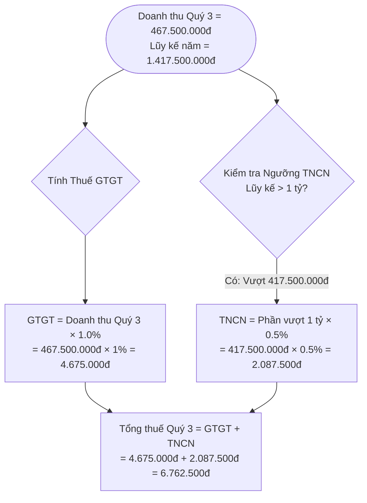
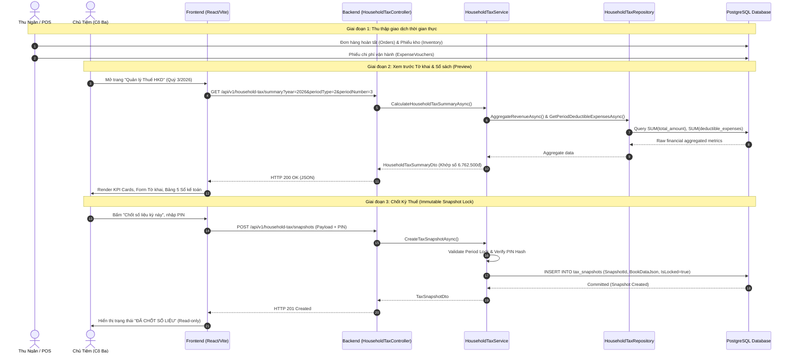
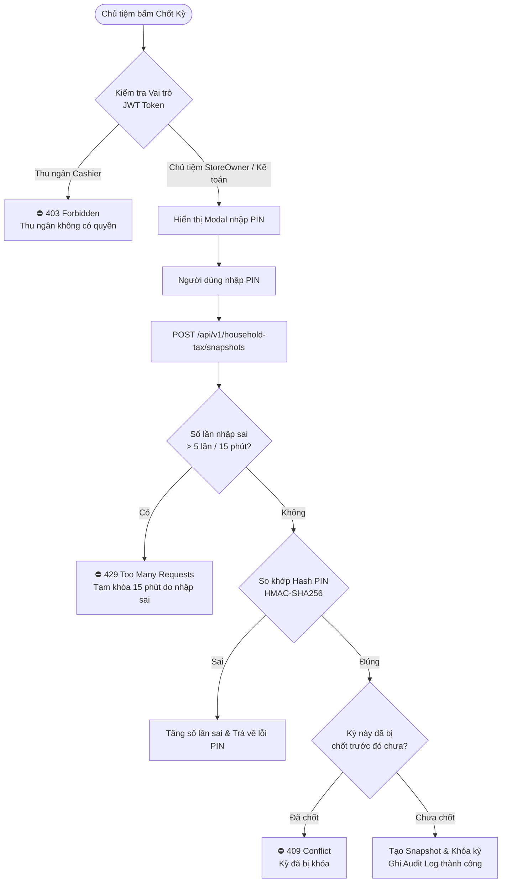

# MT-GRMS: Tài Liệu Kiến Trúc & Đặc Tả Model Tài Chính - Thuế Hộ Kinh Doanh (HKD)
> **Dành cho:** Kỹ sư phần mềm, Developer mới tham gia dự án, Kế toán trưởng & Đội ngũ kiểm thử.  
> **Phiên bản tài liệu:** 2.0 (Cập nhật chuẩn hóa chu kỳ Quý 3/2026 - Nhóm 2 HKD).  
> **Phạm vi hệ thống:** Phân hệ Tài chính, Doanh thu, Quản lý kho, Kê khai Thuế & Sổ kế toán HKD.

---

## 1. Tổng Quan & Bối Cảnh Nghiệp Vụ (System Context)

### 1.1. MT-GRMS là gì?
**MT-GRMS (Grocery Retail Management System)** là giải pháp phần mềm quản trị toàn diện dành cho các chuỗi tiệm bán lẻ và tạp hóa truyền thống chuyển đổi số. Hệ thống quản lý toàn bộ chu trình từ:
- Bán hàng tại quầy (POS) & Doanh thu thực.
- Quản lý kho, nhập hàng, giá vốn (COGS).
- Quản lý thu chi vận hành (OPEX).
- Tự động hóa tính toán nghĩa vụ thuế và lập sổ sách kế toán theo chế độ Hộ kinh doanh (HKD).

### 1.2. Mô hình nghiên cứu thực tế: "Tiệm Tạp Hóa Cô Ba"
- **Loại hình:** Hộ kinh doanh cá thể quy mô vừa trong lĩnh vực phân phối, bán buôn bán lẻ hàng tiêu dùng.
- **Quy mô doanh thu:** Đạt khoảng 1,4 – 1,8 tỷ đồng/năm.
- **Đặc thù nghiệp vụ:** Tiệm hoạt động với hàng ngàn mã hàng (SKU), biên lợi nhuận mỏng (10% – 15%), tỷ trọng giá vốn hàng bán (COGS) chiếm 70% – 85% doanh thu.
- **Thời điểm chuyển giao quan trọng:** Trong 6 tháng đầu năm (Quý 1 + Quý 2/2026), doanh thu đạt **950 triệu đồng** (dưới ngưỡng 1 tỷ nên thuộc diện miễn thuế). Đến **Quý 3/2026**, doanh thu phát sinh thêm **467,5 triệu đồng**, nâng tổng lũy kế cả năm lên **1.417,5 triệu đồng** (chính thức vượt ngưỡng 1 tỷ).

---

## 2. Quy Tắc Nghiệp Vụ Cốt Lõi (Business Rules)

### 2.1. Phân nhóm Hộ Kinh Doanh (HKD Tier Classification)
Theo quy định quản lý thuế áp dụng cho hộ kinh doanh từ năm 2026 (Nghị quyết 198/2025/QH15, Nghị định 68/2026/NĐ-CP, Nghị định 141/2026/NĐ-CP):

| Nhóm | Ngưỡng doanh thu năm | Nghĩa vụ thuế | Chế độ sổ kế toán | Phương pháp tính thuế |
| :--- | :--- | :--- | :--- | :--- |
| **Nhóm 1** | $\le 1.000.000.000\text{ đ}$ | **Miễn thuế hoàn toàn** (GTGT = 0đ, TNCN = 0đ) | Sổ đơn giản (S1a) | Miễn nộp |
| **Nhóm 2** *(Tiệm Cô Ba)* | **$> 1 \text{ tỷ đến } 3 \text{ tỷ}$** | **Chịu thuế GTGT & TNCN** | **Hệ thống Sổ S2 (S2a, S2c, S2d, S2e) & S3a** | Khai theo Quý. Chọn **Tỷ lệ doanh thu** hoặc **Kê khai (Lợi nhuận)** |
| **Nhóm 3** | $> 3 \text{ tỷ đến } 50 \text{ tỷ}$ | Chịu thuế theo Lợi nhuận thực tế | Bắt buộc hệ thống Sổ S2 đầy đủ | Bắt buộc phương pháp **Kê khai (Lợi nhuận)** |
| **Nhóm 4** | $> 50.000.000.000\text{ đ}$ | Chuyển đổi mô hình Doanh nghiệp | Chế độ kế toán Doanh nghiệp (TT 133/TT 200) | Kê khai doanh nghiệp |

> [!IMPORTANT]
> **Định danh Tiệm Cô Ba:** Tiệm thuộc **Nhóm 2**, ghi sổ **S2a-HKD**, khai thuế GTGT và TNCN theo **Quý**.

---

### 2.2. Công Thức & Cơ Chế Tính Thuế Chi Tiết

#### A. Phương pháp 1: Tính theo Tỷ lệ % Doanh Thu (Doanh thu phát sinh)
Áp dụng mặc định cho Nhóm 2 khi hộ kinh doanh chọn nộp theo tỷ lệ ấn định trên doanh thu ngành bán lẻ hàng hóa:
- **Tỷ lệ thuế GTGT chuẩn:** $1.0\%$ trên doanh thu.
- **Tỷ lệ thuế TNCN chuẩn:** $0.5\%$ trên phần doanh thu chịu thuế.



1. **Thuế Giá Trị Gia Tăng (GTGT):**
   - Thuế GTGT là thuế gián thu thu trên người tiêu dùng qua giá bán.
   - Do Quý 3 là kỳ doanh thu vượt ngưỡng, toàn bộ doanh thu phát sinh trong kỳ chịu thuế GTGT:
   $$\text{Thuế GTGT Quý 3} = 467.500.000 \times 1\% = 4.675.000\text{ VNĐ}$$
   *(Nếu bật chính sách giảm 20% theo Nghị quyết 204/2025/QH15: Tỷ lệ còn $0.8\% \implies 467.500.000 \times 0.8\% = 3.740.000\text{ VNĐ}$).*

2. **Thuế Thu Nhập Cá Nhân (TNCN):**
   - Thuế TNCN là thuế trực thu đánh trên thu nhập của chủ hộ. Theo luật, ngưỡng 1 tỷ đồng đầu tiên trong năm là thu nhập không chịu thuế.
   - Doanh thu chịu thuế TNCN = $\text{Doanh thu lũy kế năm} - 1.000.000.000\text{ đ} = 1.417.500.000 - 1.000.000.000 = 417.500.000\text{ VNĐ}$.
   $$\text{Thuế TNCN Quý 3} = 417.500.000 \times 0.5\% = 2.087.500\text{ VNĐ}$$

3. **Tổng nghĩa vụ thuế Quý 3 phát sinh thực tế:**
   $$\text{Tổng thuế Quý 3} = 4.675.000 + 2.087.500 = \mathbf{6.762.500\text{ VNĐ}}$$

---

#### B. Xử lý Vấn Đề Hồi Tố GTGT (Retroactive VAT Dilemma)
Có 2 cách hiểu nghiệp vụ thuế khi hộ vượt 1 tỷ vào Quý 3:

```
┌────────────────────────────────────────────────────────────────────────────────────────┐
│                                 HAI KỊCH BẢN THUẾ GTGT                                 │
├────────────────────────────────────────────────────────────────────────────────────────┤
│ Kịch bản 1 (Chuẩn - Phần mềm áp dụng):                                                 │
│   • Q1 + Q2 (950tr ≤ 1 tỷ): Miễn thuế = 0đ.                                            │
│   • Q3 (467,5tr): Phát sinh thuế Quý 3 = 6.762.500đ.                                   │
│   • Tổng thuế lũy kế đến hết Q3 = 6.762.500đ. (Hiển thị thẻ KPI chính của Cô Ba)       │
├────────────────────────────────────────────────────────────────────────────────────────┤
│ Kịch bản 2 (Dự phòng - Dành cho Kế toán thẩm định):                                    │
│   • Nếu cơ quan thuế ra quyết định hồi tố 1% GTGT của 950tr hai quý đầu (= 9.500.000đ) │
│   • Tổng thuế cả năm sẽ là: 6.762.500đ + 9.500.000đ = 16.262.500đ.                    │
│   • Cách ly: Chỉ hiển thị trong bảng đối soát kỹ thuật chân trang Tờ khai.             │
└────────────────────────────────────────────────────────────────────────────────────────┘
```

> [!NOTE]
> **Quy tắc thiết kế UI:** Tuyệt đối **không hiển thị con số 16.262.500đ trên thẻ KPI chính** để tránh gây hoang mang cho chủ tiệm khi cơ quan thuế chưa có thông báo truy thu chính thức.

---

#### C. Phương pháp 2: Tính theo Kê Khai (Lợi nhuận thực tế)
Dành cho HKD có đầy đủ hóa đơn chứng từ đầu vào hợp pháp:
$$\text{Thu nhập chịu thuế (Lợi nhuận)} = \text{Doanh thu} - \text{Giá vốn hàng bán (COGS)} - \text{Chi phí hợp lý (OPEX)}$$
- **Doanh thu Quý 3:** $467.500.000\text{ đ}$.
- **Chi phí vận hành hợp lý (S2c):** $3 \text{ tháng} \times 79.000.000\text{ đ} = 237.000.000\text{ đ}$ (Đã loại trừ $6.974.100\text{ đ}$ chi phí không có chứng từ hợp lệ từ tổng chi phí P&L $243.974.100\text{ đ}$).
- **Giá vốn hàng bán (COGS):** Yêu cầu Backend đồng bộ từ dữ liệu xuất kho.

---

### 2.3. Quy Tắc Dời Hạn Nộp Khi Trùng Ngày Nghỉ (Weekend Rollover)
Căn cứ Điều 8 Luật Quản lý thuế số 38/2019/QH14: Khi thời hạn nộp hồ sơ khai thuế hoặc nộp thuế trùng vào ngày nghỉ cuối tuần (Thứ Bảy, Chủ Nhật) hoặc ngày lễ theo quy định, thì ngày hết hạn được tính là **ngày làm việc tiếp theo**.

- **Hạn luật định theo quý:** Ngày cuối cùng của tháng đầu tiên quý sau $\implies 31/10/2026$.
- **Lịch thực tế năm 2026:** Ngày $31/10/2026$ rơi vào **Thứ Bảy**.
- **Thuật toán hệ thống:**
  $$\text{Statutory Deadline: } 2026-10-31 \text{ (Thứ Bảy)} \xrightarrow{+2\text{ ngày}} \mathbf{2026-11-02 \text{ (Thứ Hai)}}$$
- Logic được đóng gói trong hàm `adjustToNextBusinessDay(date)` của [taxConfig.ts](file:///d:/Sourse_code_Do_An/MT_GRMS_FRONTEND/src/features/finance/config/taxConfig.ts).

---

## 3. Kiến Trúc & Luồng Dữ Liệu Toàn Hệ Thống

### 3.1. Sơ đồ Luồng Dữ Liệu Đầu - Cuối (End-to-End Architecture)



---

### 3.2. Cấu Trúc Dữ Liệu DTO & Hợp Đồng API

#### HouseholdTaxSummaryDto (Xem trước số liệu)
```typescript
export interface HouseholdTaxSummaryDto {
  year: number;                            // 2026
  periodType: TaxPeriodType;               // 2 (Quarter)
  periodNumber: number;                    // 3 (Quý 3)
  branchId?: string;
  householdGroup: HouseholdTaxGroup;       // 2 (Doanh thu 1 - 3 tỷ)
  taxableRevenueInPeriod: number;          // 467.500.000 VNĐ
  annualAccumulatedRevenue: number;        // 1.417.500.000 VNĐ
  vatRate: number;                         // 1.0 (hoặc 0.8 nếu giảm)
  vatAmount: number;                       // 4.675.000 VNĐ
  pitRate: number;                         // 0.5
  pitAmount: number;                       // 2.087.500 VNĐ
  totalTaxAmount: number;                  // 6.762.500 VNĐ
  isTaxExempt: boolean;                    // false (vì lũy kế > 1 tỷ)
  isVatReduced: boolean;                   // true/false
  deductibleExpensesInPeriod: number;      // 237.000.000 VNĐ
  taxableIncomeDeclaration: number;        // 230.500.000 VNĐ
}
```

#### CreateTaxSnapshotRequest (Chốt kỳ thuế)
```typescript
export interface CreateTaxSnapshotRequest {
  year: number;
  periodType: TaxPeriodType;
  periodNumber: number;
  branchId?: string;
  calculationMethod: TaxCalculationMethod; // 1: Tỷ lệ doanh thu, 2: Kê khai
  applyVatReduction2026: boolean;         // Cờ giảm 20% GTGT
  pin: string;                             // Mã PIN xác thực quyền
  notes?: string;                          // Ghi chú đính kèm kỳ chốt
}
```

---

## 4. Hệ Thống 5 Sổ Kế Toán HKD (Nhóm 2)

Theo chế độ kế toán Hộ kinh doanh (Thông tư 152/2025/TT-BTC), giao diện phân hệ Thuế MT-GRMS cung cấp khung xem chỉ đọc đồng bộ với dữ liệu chốt kỳ:

```
┌─────────────────────────────────────────────────────────────────────────────────────────────────┐
│                           BỘ SỔ KẾ TOÁN HỘ KINH DOANH (NHÓM 2)                                 │
├──────────┬──────────────────────────────────────────┬───────────────────────┬───────────────────┤
│ Mã Sổ    │ Tên Sổ Kế Toán                          │ Dữ liệu Quý 3/2026    │ Trạng thái Nguồn  │
├──────────┼──────────────────────────────────────────┼───────────────────────┼───────────────────┤
│ S2a-HKD  │ Sổ chi tiết doanh thu bán hàng hóa, DV   │ 467.500.000 VNĐ       │ Khớp POS Orders   │
│ S2c-HKD  │ Sổ chi phí sản xuất, kinh doanh          │ 237.000.000 VNĐ       │ Khớp Vouchers     │
│ S2d-HKD  │ Sổ chi tiết vật liệu, dụng cụ, hàng hóa  │ Tồn kho 142.000.000đ  │ Chờ DTO Sổ kho    │
│ S2e-HKD  │ Sổ theo dõi tình hình nghĩa vụ thuế      │ 359.300.000 VNĐ       │ Link "Tiền của tôi"│
│ S3a-HKD  │ Sổ theo dõi thanh toán tiền thuế         │ 6.762.500 VNĐ         │ Khớp Tờ khai Thuế │
└──────────┴──────────────────────────────────────────┴───────────────────────┴───────────────────┘
```

1. **S2a-HKD (Doanh thu):** Ghi chép từng giao dịch xuất bán hàng, phân tách doanh thu bán buôn, bán lẻ làm căn cứ trực tiếp tính thuế GTGT và TNCN.
2. **S2c-HKD (Chi phí):** Tổng hợp chi phí nhân công, tiền điện, nước, thuê mặt bằng. Chỉ ghi nhận các khoản chi có hóa đơn chứng từ hợp pháp.
3. **S2d-HKD (Kho & Hàng hóa):** Theo dõi số lượng, đơn giá, thành tiền Nhập - Xuất - Tồn của từng SKU. Đây là cơ sở cốt lõi để tính Giá vốn hàng bán (COGS).
4. **S2e-HKD (Sổ quỹ & Nghĩa vụ thuế):** Liên kết trực tiếp với phân hệ Dòng tiền ("Tiền của tôi"), đối soát số dư tiền mặt thực tế sẵn sàng nộp thuế ($359.300.000\text{ đ}$).
5. **S3a-HKD (Nghĩa vụ nộp ngân sách):** Ghi nhận số thuế phát sinh theo thông báo và số thuế thực nộp vào Kho bạc Nhà nước.

---

## 5. Cơ Chế Snapshot Bất Biến & Bảo Mật (Security & Immutability)

### 5.1. Tại sao cần Snapshot Bất Biến (Immutable Snapshot)?
Trong bán lẻ, hóa đơn, phiếu nhập kho hoặc phiếu chi của các tháng trước có thể bị nhân viên vô tình sửa đổi, xóa hoặc hủy. Nếu phân hệ thuế tính toán động trực tiếp từ bảng giao dịch, số thuế đã báo cáo cơ quan thuế tháng trước sẽ bị lệch khi xem lại.
- **Giải pháp:** Khi chủ tiệm bấm **Chốt số liệu kỳ này**, toàn bộ trạng thái tính toán, bảng biểu và cấu hình thuế tại thời điểm đó được đóng gói thành một tài liệu JSON (`BookDataJson`) và lưu vào bảng `tax_snapshots` với cờ `is_locked = true`.
- **Nguyên tắc:** **Snapshot một khi đã tạo thì KHÔNG THỂ SỬA ĐỔI HOẶC XÓA BẰNG BẤT KỲ API NÀO.** Nếu phát hiện sai sót, người dùng phải tạo một bản ghi điều chỉnh (Adjustment Snapshot) kèm theo vết kiểm toán (Audit Trail).

### 5.2. Luồng Xác Thực Quyền & Bảo Vệ Mã PIN



---

## 6. Hướng Dẫn Kỹ Sư Phát Triển & Tiếp Nhận Mã Nguồn (Developer Guide)

### 6.1. Cấu Trúc Thư Mục Frontend
Các tệp nguồn nằm tại `MT_GRMS_FRONTEND/src/features/tax-snapshot/`:
- [TaxSnapshotPage.tsx](file:///d:/Sourse_code_Do_An/MT_GRMS_FRONTEND/src/features/tax-snapshot/pages/TaxSnapshotPage.tsx): Trang chính, điều phối Tab Tờ khai, Tab 5 Sổ kế toán, Bộ lọc kỳ và Drawer lịch sử.
- [TaxKPICards.tsx](file:///d:/Sourse_code_Do_An/MT_GRMS_FRONTEND/src/features/tax-snapshot/components/TaxKPICards.tsx): Thẻ KPI doanh thu, thuế GTGT, TNCN, Quý 3 và Lũy kế.
- [TaxDeclarationFormView.tsx](file:///d:/Sourse_code_Do_An/MT_GRMS_FRONTEND/src/features/tax-snapshot/components/TaxDeclarationFormView.tsx): Tờ khai thuế chi tiết, toggle phương pháp tính, giảm thuế 20% và bảng phân tích hồi tố cho kế toán.
- [AccountingBooksView.tsx](file:///d:/Sourse_code_Do_An/MT_GRMS_FRONTEND/src/features/tax-snapshot/components/AccountingBooksView.tsx): Giao diện 5 sổ kế toán S2a, S2c, S2d, S2e, S3a.
- [taxConfig.ts](file:///d:/Sourse_code_Do_An/MT_GRMS_FRONTEND/src/features/finance/config/taxConfig.ts): Cấu hình ngưỡng miễn thuế 1 tỷ, tỷ lệ thuế và hàm dời ngày nghỉ `adjustToNextBusinessDay`.
- [taxSnapshotApi.ts](file:///d:/Sourse_code_Do_An/MT_GRMS_FRONTEND/src/features/tax-snapshot/api/taxSnapshotApi.ts): Tầng giao tiếp HTTP với backend, xử lý mock fallback khi chạy phát triển.

### 6.2. Các "Quy Tắc Vàng" Khi Viết Code (Developer Invariants)
1. **Không tính thuế ở Client:** Giao diện chỉ hiển thị những gì nhận được từ `HouseholdTaxSummaryDto`. Tuyệt đối không tự viết công thức nhân chia thuế trong file JSX/TSX.
2. **Không tự ý đưa số hiệu điều luật chưa kiểm chứng vào UI:** Nếu chưa đối chiếu văn bản gốc trên cổng thuế, chỉ dùng thuật ngữ chung (*"theo quy định quản lý thuế hiện hành"*).
3. **Single Source of Truth:** Mọi con số tài chính trên giao diện phải liên kết khớp với dữ liệu gốc của Quý 3:
   - Doanh thu: $467.500.000\text{ đ}$
   - Chi phí hợp lý: $237.000.000\text{ đ}$
   - Thuế Quý 3: $6.762.500\text{ đ}$
   - Tiền quỹ: $359.300.000\text{ đ}$
4. **Bảo mật mã PIN:** Mã PIN không bao giờ được kiểm tra bằng câu lệnh `if (pin === '1234')` ở Frontend. Luôn gửi PIN lên máy chủ để xác thực hash an toàn.

---

## 7. Các Đầu Việc Backend Cần Hoàn Thiện Tiếp Theo
1. **Bổ sung Giá vốn hàng bán (COGS):** Sửa `HouseholdTaxRepository.GetPeriodDeductibleExpensesAsync` để tính thêm chi phí xuất kho vào chi phí được trừ khi tính thuế theo phương pháp Kê khai.
2. **Endpoint Sổ kho S2d:** Cung cấp API `GET /api/v1/household-tax/accounting-books/inventory-detail` trả về bảng nhập xuất tồn từng mã hàng.
3. **Bảo mật Controller:** Bổ sung `[Authorize(Roles = "StoreOwner,ChiefAccountant")]` cho `HouseholdTaxController.cs`.
